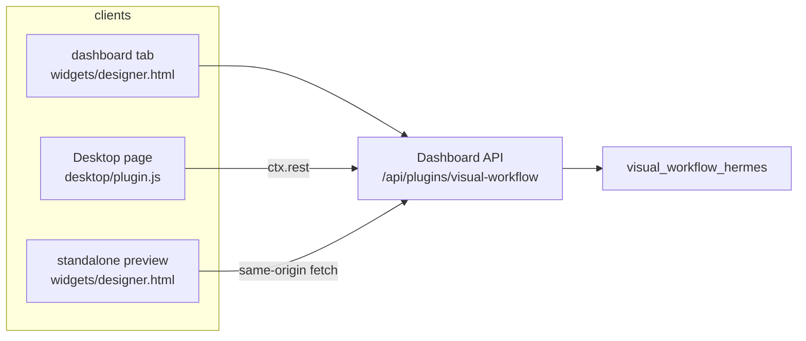
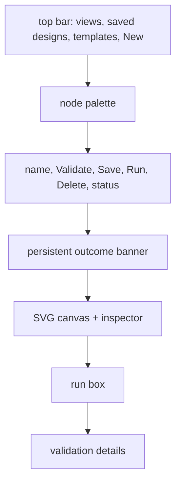

# Canvas Frontends

Three surfaces render the same workflow canvas, and one HTTP router serves all of them. The
surfaces exist because Hermes plugins are hosted in different places — the web dashboard, the
Desktop app, and a bare `file://` preview — and none of them has a build step the others can
share.

## The three copies

| Surface | File | Transport | Why it exists |
| --- | --- | --- | --- |
| Web dashboard | `dashboard/dist/index.js` | `fetch` with same-origin credentials | The Workflows tab the host serves in the browser |
| Desktop page | `desktop/plugin.js` | `ctx.rest` (authenticated by the host) | Native `/workflows` route and sidebar row in the Desktop app |
| Standalone | `widgets/designer.html` | `fetch` when a server is present | A dependency-free canvas openable as a file, used by the chat preview hint and by manual checks |

The canvas core is copied rather than imported. There is no bundler in any of these surfaces, so
`edgeKey`, the cron helpers, the tooltip table, and the node styling are duplicated. That
duplication is a known cost, and it is pinned by tests: `tests/test_canvas_ui.py` executes the
cron and edge-key helpers from every copy, `tests/test_tooltips.py` requires every tooltip key in
all copies, and `tests/test_canvas_contract.py` drives each copy with payloads shaped exactly as
the GUI builds them.

## Shared layout

All copies render the same regions:

The designer, Runs, and Schedules views share one page because the host allows one route per
plugin. `showView` swaps the canvas for the runs list or the cron job list.

## What belongs where

- [Dashboard API](canvas-frontends/dashboard-api.md) — routes, HTTP status policy, run/resume
  semantics. Read this first if you are changing a network call.
- [Canvas Core](canvas-frontends/canvas-core.md) — drawing, geometry, dragging, linking, fitting,
  and the client cron helpers.
- [Canvas Inspector](canvas-frontends/canvas-inspector.md) — the per-kind form, catalog pickers,
  and the banner/error surfaces.
- [Canvas Runs and Schedules](canvas-frontends/canvas-runs-schedules.md) — the runs list, gate
  answering, retry, cron job controls, and the run box.
- [Canvas Design Lifecycle](canvas-frontends/canvas-design-lifecycle.md) — loading, validating,
  saving, running, templates, and the Desktop mount/destroy lifecycle.
- [Standalone Widget](canvas-frontends/standalone-widget.md) — the dependency-free
  `widgets/designer.html` surface and how it differs from the Desktop copy.

## Contracts that keep the copies honest

1. **Payload shape** — the GUI posts `{graph: {name, nodes}}`; `after` is the only edge
   representation. Layout `x`/`y` are widget-only and ignored by the backend.
2. **Node vocabulary** — five runnable kinds plus note; `KINDS` excludes note, `PALETTE` includes
   it. `node-spec.json` is the machine-readable copy both the schema and the canvases are tested
   against.
3. **Tooltip keys** — every control's tooltip key must exist in every copy. A missing key renders
   a literal "undefined" title, which is a documentable bug, not a cosmetic one.
4. **Cron parity** — the client's `buildCron`/`cronProblem` must accept and reject exactly what
   `visual_workflow_hermes/schedule.py` does, or the canvas will save a schedule the server
   refuses (or the reverse).

## Related documentation

- [Plugin Backend](plugin-backend.md) — the code behind the API
- [Build and Packaging](repo-operations/build-and-packaging.md) — how the widget ships as a data
  file
- [Live Probes](repo-operations/live-probes.md) — the Playwright checks that measure these
  surfaces
- [Testing](testing.md) — the parity tests that keep the three copies honest
