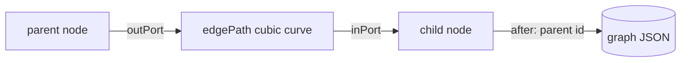

# Canvas Core

The drawing and interaction engine of the workflow designer: an SVG graph rendered with plain
DOM, node dragging, edge linking with cycle prevention, viewport fitting, sticky-note tints, and
a local mirror of the server's cron helpers.

- Source: `desktop/plugin.js` (lines ~1–900)
- Factory: `createDesigner(host, call)` mounts the whole surface; the core functions live in its
  closure and operate on the local `graph`.

The same engine, copied rather than imported, powers three surfaces: the Desktop plugin, the web
dashboard bundle, and the standalone [`widgets/designer.html`](standalone-widget.md). There is no
build step to share a module, so parity is maintained by tests (`tests/test_canvas_ui.py`,
`tests/test_canvas_contract.py`).

## Design decisions

| Decision | Reason |
| --- | --- |
| Vanilla DOM/SVG, React only for the mount point | The graph never lives in the host's render tree; dragging does not re-render the app |
| Fixed virtual sheet + `viewBox` | A narrow tab scales the graph down instead of clipping it |
| `JSON.stringify([from, to])` as an edge key | An id may contain `>`; `from + ">" + to` both collides and cannot be parsed back |
| Transparent 12px twin for each edge | A 1.6px stroke is nearly impossible to hit |
| Paint via `style`, other attributes via `setAttribute` | `var()` is valid in CSS but not as an SVG presentation attribute; it would compute black |

## Layout and geometry

Constants: `NODE_W`, `NODE_H = 58`, `PORT_R = 5`. Every node has an output port on its right
edge; every node except a trigger has an input port on its left. `outPort`/`inPort` return the
connection points, and `edgePath` draws a cubic Bézier whose bend is at least 30px or half the
horizontal gap.

`layout()` assigns a grid position to any node without numeric `x`/`y`: four per row, 172px
apart horizontally, 92px vertically. Layout keys are widget-only and round-trip through the
saved JSON unchanged.

## Edge identity

`edgeKey(from, to)` is JSON, not a delimiter join. The key is also parsed back when a selected
edge is deleted (`removeSelected` does `JSON.parse`), so a delimiter inside an id would both
collide (`a>b -> c` vs `a -> b>c`) and yield the wrong pair. JSON keeps the pair unambiguous
without a reserved character in the id charset.

## Drawing

`draw()` rebuilds the SVG from the graph:

1. edges first, from parent output to child input, each with its click/double-click handlers and
   an invisible hit path carrying `data-edge`;
2. the drag ghost, when a link is in flight;
3. nodes in order: a `<title>` tooltip, a rounded rect (dashed for notes, tinted by
   `noteColor`), the kind label, the id, and up to two preview lines from `previewLines`;
4. ports on non-note nodes — output always, input unless it is a trigger;
5. `fit()` unless a gesture has locked the viewport.

An edge click selects it and clears the node selection; a double-click cuts it immediately.
Notes have no ports at all, so there is nothing to drag from or drop onto.

## Dragging and linking

`wireNode` starts a node drag on left mousedown, ignoring presses that began on a port. It
tracks a movement threshold of 3px so a click is a selection, not a zero-distance drag. Redraws
are coalesced with `requestAnimationFrame`; without that, every pixel rebuilds the whole SVG.

`beginLink` starts from an output port. A drag that ends over another node calls
`finishLink(from, target)`; a click without movement arms the port (`linkArm`) so the next input
port click completes it. `finishLink` refuses, with a sentence in the status line:

- a note as either endpoint;
- a trigger as a target;
- self-dependency;
- an edge that would close a loop (`createsCycle` walks up from the source);
- a duplicate edge.

`cutEdge` removes one dependency and clears the selection. `removeSelected` deletes the selected
edge (via its JSON key) or the selected node plus every reference to it.

Gesture cleanup is deliberate: `pointercancel` and `window.blur` cancel the drag, close the
document listeners, release `fitLocked`, and redraw. A drag released off-window must not leave a
ghost or a frozen viewport.

## Fitting

`fit()` sets the SVG `viewBox` to the graph's bounds plus 30px padding, at least 320×200, and
sizes the rendered width to the wrapper (never above 1:1, so text stays crisp). Only width is
measured; height follows the aspect ratio and the wrapper scrolls. `watchSize` uses a
`ResizeObserver` and ignores a detached wrapper, so a torn-down page stops fitting a canvas
nobody can see.

## Status, banner, and errors

- `note(text)` writes one line into the toolbar.
- `banner(message, kind)` is the persistent outcome strip above the canvas, with `info`, `warn`,
  and `error` variants, `role="status"` and `aria-live="polite"`, and a dismiss button.
- `showErrors(errors)` fills the details box under the canvas.
- `setInspector(open)` collapses/expands the 252px inspector; a selection opens it.

Validation writes both the banner sentence and the details box, so a count and its explanation
are visible together rather than one replacing the other.

## Cron helpers (client mirror)

`timeParts`, `weekdayIndex`, `buildCron`, `cronFieldOk`, `cronProblem`, `describeCron`,
`presetOf`, `timeOf`, and `weekdayOf` mirror `visual_workflow_hermes/schedule.py` for immediate
feedback. They must not drift:

- `buildCron` uses the same preset vocabulary and produces the same expression;
- `cronFieldOk` bounds each field (minute 0–59, hour 0–23, day 1–31, month 1–12, day-of-week
  0–7) and requires exactly two `/` segments, so `*/15/2` and `5/10/extra` are rejected;
- `describeCron` never renders `NaN`: a non-numeric hour or minute reads as "every hour" or
  falls back to `Cron <expression>`;
- `weekdayOf` maps cron's 0/7 Sunday to the picker's Monday-first list;
- `presetOf` returns `custom` for a list/step weekday, because calling it "weekly" would coerce
  it to one day when the picker rebuilds the expression.

`tests/test_canvas_ui.py` executes these helpers from every canvas copy against boundary cases,
so the three surfaces cannot silently diverge on these defects.

## Constants shared with the schema

`KINDS` is the five runnable kinds; `PALETTE` adds `note`; `NOTE_COLORS` is the four tints;
`MODES` is `manual`/`schedule`. These mirror `schema.py` and are pinned by contract tests.

## Related documentation

- [Canvas Inspector](canvas-inspector.md) — the right-hand form
- [Canvas Design Lifecycle](canvas-design-lifecycle.md) — API calls and mounting
- [Canvas Runs and Schedules](canvas-runs-schedules.md) — the other two views
- [Schema Validation](../plugin-backend/schema-validation.md) — the authoritative rules
