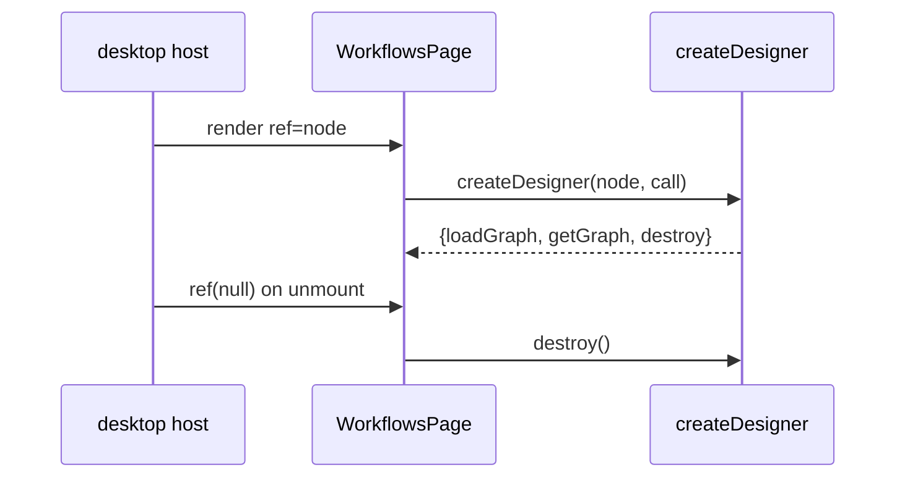

# Canvas Design Lifecycle

Everything that moves a design between the canvas and the server: loading a graph, validating a
draft, saving, running, answering a run, opening templates, and mounting/destroying the page.
This is also where the Desktop half of the plugin lives — the module that the desktop host loads
as raw ESM and whose default export registers the `/workflows` route and sidebar row.

- Source: `desktop/plugin.js` (lines ~1480–1900 for the design calls, ~2390–2568 for mounting)
- Export: `{id, name, description, register(ctx)}`
- Backend door: `ctx.rest(path, opts)`, scoped to `/api/plugins/visual-workflow`

## Host integration

The desktop host reads this file as text, rewrites the two allowed specifiers
(`@hermes/plugin-sdk`, `react*`) to its live shims, imports it, validates the default export, and
calls `register(ctx)`. Only those specifiers resolve — there is no bundler, no npm dependency, and
no `fetch` or token handling in the plugin. `ctx.rest` is the authenticated door.

`register` adds two contributions:

| Area | Contribution |
| --- | --- |
| `routes` | full page at `/workflows`, title "Workflows" |
| `sidebar.nav` | row `{codicon: "project", label: "Workflows", path: "/workflows"}` |

## Mounting without React hooks

The SDK exposes no React hooks and maps only `react/jsx-runtime`, so the page is a pure-jsx shell
whose `ref` callback mounts the vanilla designer:

Two details matter:

- `mount` has a stable identity, created once, so React attaches it on mount and calls it with
  `null` on unmount instead of remounting the canvas on every host re-render.
- `node.__vwDesigner` guards against a second mount on the same element.

`destroy()` cancels any in-flight drag/link gesture, disconnects the `ResizeObserver`, and clears
the inspector. Without it, `fit()` would keep running against a canvas nobody can see.

## Loading a graph

`loadGraph(next)` accepts a saved design, a template, or a blank graph and treats it as
**untrusted input**:

- a non-object, a non-list `nodes`, or an empty list falls back to the blank design;
- nodes without a non-empty string `id` are dropped;
- `after` is normalised to an array of strings;
- non-finite `x`/`y` are deleted so `layout()` assigns positions;
- a missing `name` becomes `"untitled"`;
- selection, link arm, drag ghost, last run, errors, status, and banner are reset;
- the name field is filled, the inspector closes, layout runs, and the canvas redraws.

A regressed design used to reach `layout()` with a non-list `nodes` and throw, leaving a blank
canvas with no explanation; the sanitisation is what turns that into a usable fallback.

## Templates

Templates are drafts, not saved designs. `useTemplate(name)` clones the template's graph onto the
canvas and clears `active`, so Save stores it under the user's own name. An empty template list
means an older plugin copy, not a broken tab: the select is disabled and says "no templates".

## Validate, save, run

All three go through the same `payloadGraph()`: `{name: currentName() || "workflow", nodes:
clone(graph.nodes)}`. Layout keys travel with the nodes; the server ignores them.

### Validate

`validateDraft()` posts the draft graph to `/designs/{name}/validate`. On success it clears the
detail box and shows a banner with the node count. On defects it fills the details box and shows
a banner saying how many problems there are. A transport or server error is **not** treated as a
local verdict: the catch branch shows "Validate failed — <reason>" and the request error in the
details box.

### Save

`saveDesign()` refuses an empty name, posts to `/designs/{name}`, and on success:

- sets `active` and adds the name to `savedNames` immediately, so pressing Run right after Save
  cannot be refused as "not saved yet";
- clears errors, sets the status line and banner, and refreshes the saved-design list.

On defects it shows the server's list and a "not saved" banner. On a transport error it shows
"Save failed — <reason>".

### Run

`runDesign()` refuses an empty name. It gates a never-saved draft only when the design list has
actually loaded (`designsLoaded`): before that, the POST is authoritative. A name that is not in
the list gets a sentence ("press Save, then Run") instead of a 404 nobody sees.

On `status: "invalid"` it shows the defects and does not run. Otherwise it renders the result in
the run box, which handles all statuses.

## Answering and retrying

- `respond(nodeId, answer)` posts to `/runs/{id}/respond`. A JSON object literal is sent as
  `structured` plus the text answer, so conditions can read fields.
- `respondByAgent(nodeId)` posts `agent_generate: true`; the host produces the parked step's
  output through the same LLM facade a Run uses, and the run continues. A 503 means this
  dashboard has no backend, and the user can paste the result instead.
- `retryFailedRun()` posts `/runs/{id}/retry` and is offered only for a failed run.

A failed resume never discards the run: the server leaves it parked, and the error banner tells
the user what happened.

## Freshness after save

`refreshDesigns()` fetches `GET /designs`, updates the select, and records `savedNames` +
`designsLoaded = true`. A failed initial fetch deliberately leaves `designsLoaded` false, so Run
does not gate on an empty cache and lets the POST return the authoritative 404.

## Error text

`explain(err)` extracts the server's `detail` from a rest error whose message carries an HTTP
status and a JSON body, returning a readable sentence instead of "Error: 400: {json}". This is the
only error munging in the client; everything else shows `explain(err)` verbatim in the banner,
detail box, or rail error line.

## Related documentation

- [Dashboard API](dashboard-api.md) — the routes this module calls
- [Canvas Core](canvas-core.md) — the drawing engine mounted here
- [Canvas Runs and Schedules](canvas-runs-schedules.md) — the run box these calls render into
- [Scheduling](../plugin-backend/scheduling.md) — the server side of the schedule form
