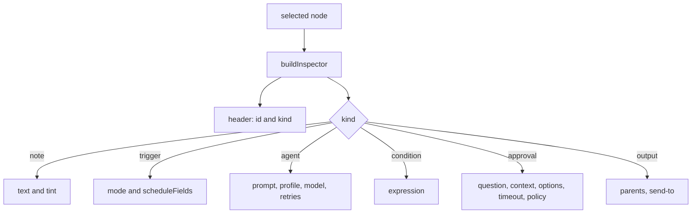

# Canvas Inspector

The right-hand form that edits the selected node. It builds plain DOM controls per node kind,
wires each one straight into the node object, and degrades gracefully when the host catalog is
unavailable. It also owns the catalog refreshes that fill the profile, model, and channel
pickers.

- Source: `desktop/plugin.js` (lines ~900–1500)
- Entry point: `buildInspector()`, called on selection, after graph loads, and after a schedule
  change.

## Structure

With nothing selected the inspector collapses and says "Select a node to edit it." A selection
opens it; the toggle closes it.

## Controls by kind

| Kind | Control | Stored field |
| --- | --- | --- |
| note | textarea | `text` |
| note | tint select | `color` (yellow/blue/green/red) |
| trigger | mode select | `trigger_mode` (`manual`/`schedule`) |
| trigger | schedule picker | `schedule` (cron) |
| agent | prompt textarea | `prompt` |
| agent | profile select | `profile` |
| agent | model select or text | `model` |
| agent | retries text | `retries` (clamped to 3) |
| condition | expression input | `expression` |
| approval | question, context | `question`, `context` |
| approval | options input | `options` (comma split) |
| approval | timeout input | `timeout_minutes` |
| approval | timeout policy | `on_timeout` (`reject`/`escalate`) |
| output | parents (read-only) | derived from `after` |
| output | send-to picker or text | `deliver` + `target` |

Every field is a controlled-by-node control: the input handler mutates the node and calls
`draw()` so the canvas preview updates while typing. Optional fields are deleted rather than set
to empty when cleared, keeping the saved JSON close to what the user wrote.

## Send-to compresses two fields into one choice

The backend reads `deliver` and `target`; the user should choose one thing. `applySendTo` derives
both from one value:

- empty → collect only (both fields deleted);
- bare platform (`telegram`) → `deliver: "notification"`, target unchanged;
- `platform:chat` → `deliver: "channel"`.

`sendToValue` is the inverse for rendering. Deriving both fields from one value is what makes an
invalid pair impossible to build in the UI, though the validator still checks hand-written JSON.

## Schedules inside the inspector

`scheduleFields(node)` renders the friendly picker: preset, weekday (weekly only), time (all but
custom — hourly keeps it because `buildCron` takes the minute from it), an advanced cron input,
a live reading, the host-job status, and a "Schedule in Hermes" button.

- `node.schedule` is the single source of truth, so the saved design and the created cron job
  cannot disagree.
- The reading is recomputed from the current expression and switches between hint and error
  styling; invalid input says "time must be HH:MM (24h)" instead of silently discarding it.
- The status line reads `GET /schedules` and states whether Hermes really has a job for this
  design, its next run, or that the scheduler could not be read.
- The button refuses to schedule an unsaved design or an invalid cron, and reports the server's
  error text when the scheduler refuses.

## Catalog-driven pickers

`refreshProfiles`, `refreshModels`, and `refreshChannels` fetch the three catalogs once at mount
and fill module-level arrays. Failure is not fatal: an empty list leaves the corresponding field
usable.

| Catalog | Empty result | Fallback |
| --- | --- | --- |
| profiles | no bots listed | profile select shows the placeholder |
| models | no catalog | model field becomes a free-text input |
| channels | no chats discovered | output target becomes a free-text input |

Saved values that the catalog no longer lists are appended as "(not found)" / "(not listed)"
options and selected. Opening a design must never silently reset a profile, model, or target
that the host stopped advertising.

## Refresh without stealing the cursor

`refreshInspector()` rebuilds the drawer only when focus is **outside** the inspector. A catalog
response that lands while the user is typing a prompt must not wipe the control, its cursor, or
its selection. Callers (`refreshProfiles/Models/Channels`) use it instead of calling
`buildInspector` directly.

This matters because the fetches resolve after first paint: the user can already be editing when
the response arrives.

## Field helpers

- `field(label, control, tip)` builds a labelled row and puts the tooltip on both the label and
  the control. A native `title` is the whole mechanism — it works in a hosted page, in plain DOM,
  and has no dependency.
- `textInput`, `textArea` attach an `input` listener and call the supplied setter.
- `profileByName` resolves a profile for the "runs as" hint.

## Outcome surfaces

The inspector module also owns the three status helpers shared with the rest of the canvas:

| Helper | Surface | Lifetime |
| --- | --- | --- |
| `note(text)` | one line in the toolbar | replaced by the next action |
| `banner(text, kind)` | strip above the canvas, `role=status` | until dismissed or replaced |
| `showErrors(list)` | details box under the canvas | until the next validation |

A run outcome must never be only a transient word in the toolbar, which is why banner exists.
Validation writes the banner sentence *and* the detail list; neither overwrites the other.

## Related documentation

- [Canvas Core](canvas-core.md) — selection, drawing, and cron helpers
- [Host Catalogs](../plugin-backend/host-catalogs.md) — the APIs behind the pickers
- [Scheduling](../plugin-backend/scheduling.md) — the server side of the schedule form
- [Canvas Design Lifecycle](canvas-design-lifecycle.md) — save/validate/run buttons
