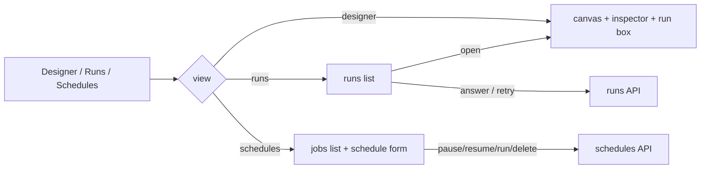

# Canvas Runs and Schedules

The two non-designer views of the Workflows page, plus the run box under the canvas. Together
they make a run observable and answerable from the GUI without returning to chat: see what ran,
answer a gate, retry a failure, and control the cron jobs this plugin created.

- Source: `desktop/plugin.js` (lines ~1500–2000 for the views, ~2200–2470 for the run box)
- View switch: `showView("designer" | "runs" | "schedules")`

## One page, three views

The host allows one route per plugin, so the page keeps a rail of three buttons and swaps the
content. `showView` toggles `hidden` on the app, the runs panel, and the schedules panel, sets
`aria-pressed` on each button, and refreshes the incoming view.

## Runs view

`renderRuns()` calls `GET /runs?limit=20` and renders every run saved on the machine, newest
first — including runs started in chat or by a cron job, which the page previously could not see.

Each row shows the design name, status, run id, and `ageText(updated)` ("3m ago", "2d ago").
Status-specific detail:

- **awaiting_approval** — the question, a deadline line from `waitText`, and one button per
  option. A gate with no options says it takes free text and must be answered in chat.
- **awaiting_agent** — says the step is paused and offers **Open**, which loads the design and
  the run into the designer's run box, where the result can be pasted or generated.
- **failed** — the error message, a chip with the diagnosed `kind` (hint in its tooltip), and a
  **Retry** button.
- **deliveries** — `sent`/`FAILED` per output node, with the target and error detail.

`answerRun` posts `{run_id, node_id, answer}` and re-renders. `retryStoredRun` posts to
`/runs/{id}/retry`. Both surface a refusal in the rail error line rather than failing silently.

`openRun(run)` loads the design by name, switches to the designer, fetches the run, and renders
it in the run box. That is the path from "agent step paused" to "paste its output and resume".

### Time formatting

`ageText` accepts epoch seconds, milliseconds, and ISO strings. An unknown or unparseable value
returns "unknown age" instead of rendering `NaN d ago`.

`waitText(pending)` renders a timed gate as "waiting 12m · expires in 48m", or "past its
60-minute deadline" once it has expired. A gate without `timeout_minutes` or `waiting_since`
returns an empty string — no invented deadline.

## Schedules view

`renderSchedules()` calls `GET /schedules`:

- `available: false` → an explicit "the host scheduler could not be read here" message;
- no jobs → "No scheduled workflows yet";
- otherwise a row per job.

`jobRow(job)` shows the design name, state, next run, and a human reading of the cron expression.
Actions: **Pause** (disabled when already paused), **Resume** (disabled unless paused), **Run
now**, **Delete**. Each posts to `/schedules/{job_id}/{action}` and re-renders; a refusal lands
in the rail error line.

`scheduleForm()` creates or updates a job:

1. pick a saved workflow;
2. choose a preset, day (weekly), time (all but custom), or a cron expression (custom);
3. `currentExpression()` recomputes the expression from the **live** picker state on every
   change. Computing it once at render and closing over it made "change the time, press
   Schedule" submit the old expression;
4. **Schedule it** validates, posts `{preset, time, weekday, cron}`, and reports "scheduled" vs
   "updated" with a human reading.

The form is also the second call site for `/designs/{name}/schedule`; it uses the same body shape
as the inspector's button so the two cannot drift.

## Run box

`renderRun(result)` is the detailed outcome under the canvas. It scrolls itself into view, writes
the bare status into the toolbar, and pins a banner sentence for the outcome. Per status:

| Status | Run box content |
| --- | --- |
| `awaiting_approval` | gate heading, context, deadline, option buttons or a free-text area and Send |
| `awaiting_agent` | step heading, prompt, context, "Run this step with the agent", a paste area and "Send result & resume" |
| `failed` | heading, raw message, diagnosed chip, **Retry run**, delivery receipts |
| `done` | output keys, skipped nodes, delivery receipts, pretty-printed outputs |
| anything else | status heading and the error if present |

`respond(nodeId, answer)` posts the answer. If the answer is a JSON object literal, it is sent as
`structured` **and** as the text answer, so downstream conditions can read fields while the raw
text remains for display. `respondByAgent(nodeId)` posts `agent_generate: true` and lets the host
facade produce the step's output.

`retryFailedRun` posts `/runs/{id}/retry` and is offered only for a failed run; a parked gate is
answered, not restarted.

## Failure diagnosis in the UI

A diagnosed failure records `{node_id, msg, kind?, hint?}`. Both the row and the run box render
`kind` as a `.vw-chip` whose `title` is `hint`. The raw `msg` always stays as the visible
evidence; the chip is advisory, never a replacement for the message. No diagnosis means no chip,
so old failures look exactly as before.

## Related documentation

- [Dashboard API](dashboard-api.md) — the endpoints these views call
- [Sequential Runner](../plugin-backend/sequential-runner.md) — statuses and retry rules
- [Scheduling](../plugin-backend/scheduling.md) — cron building and job actions
- [Canvas Inspector](canvas-inspector.md) — the banner and error surfaces
