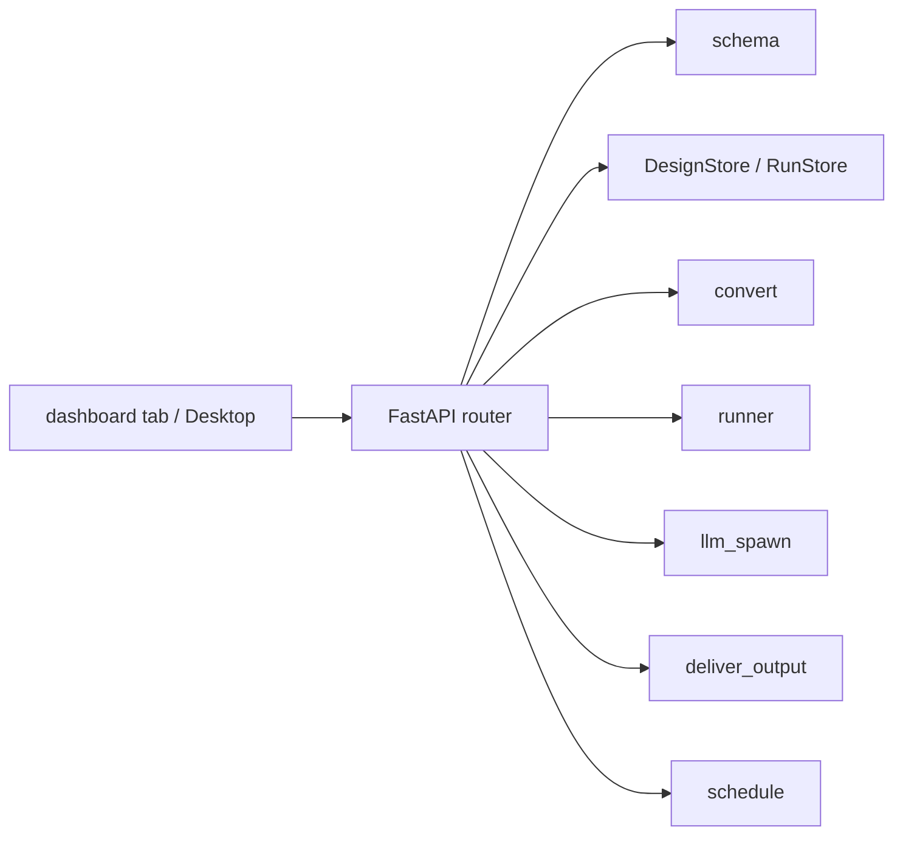

# Dashboard API

The FastAPI router the Hermes dashboard mounts at `/api/plugins/visual-workflow/`. It is the
single backend for both web surfaces (the dashboard tab and the Desktop app) and is a thin
wrapper over the plugin's own modules — the same store, converter, runner, and delivery code the
chat tools use — so the GUI and chat cannot drift.

- Source: `dashboard/plugin_api.py`
- Mount point: `/api/plugins/visual-workflow`
- Router: `APIRouter` imported by the host's plugin loader.

## Why a thin layer

Every route does three things: resolve the home directory for this request, call the plugin
module, and translate expected failures into HTTP. Business rules stay in
[`schema.py`](../plugin-backend/schema-validation.md), [`runner.py`](../plugin-backend/sequential-runner.md),
and friends; a rule implemented twice would eventually disagree with itself.

## Routes

| Method | Path | Purpose |
| --- | --- | --- |
| GET | `/models` | host model catalog; `refresh=1` drops the cache |
| GET | `/profiles` | host profiles (bots) |
| GET | `/channels` | delivery targets from the channel directory |
| GET | `/designs` | saved design names |
| GET | `/designs/templates` | built-in designs from `examples/` |
| GET | `/designs/{name}` | one saved graph |
| POST | `/designs/{name}` | validate and save `{graph}` |
| POST | `/designs/{name}/validate` | validate a saved design or a draft `{graph}` |
| POST | `/designs/{name}/run` | run now until done or paused |
| GET | `/schedules` | cron jobs this plugin created |
| POST | `/designs/{name}/schedule` | create or update the job |
| POST | `/schedules/{job_id}/{action}` | pause / resume / run / remove |
| GET | `/runs` | recent runs, newest first (`limit`, default 20) |
| GET | `/runs/{run_id}` | one run in result shape |
| POST | `/runs/{run_id}/respond` | answer a gate or supply agent output |
| POST | `/runs/{run_id}/retry` | retry a failed run |

`/designs/templates` is declared before `/designs/{name}` on purpose: FastAPI matches routes in
registration order, so the reverse order would treat "templates" as a design name.

## Home resolution

`_home()` prefers the host's `get_hermes_home()` because it honours the dashboard's per-request
profile scope; without the host it falls back to `$HERMES_HOME`. It deliberately does **not**
swallow an error from the host function: silently falling back to another directory would split
designs and runs between homes and make them look vanished.

## Expected outcomes are 200

A design problem is not a transport problem. These return HTTP 200 with a body that says what
is wrong, so the canvas can paint defects inline:

- invalid graph on save → `{"ok": false, "errors": [...]}`;
- invalid graph on run → `{"ok": false, "status": "invalid", "errors": [...]}`;
- validation defects → `{"ok": false, "valid": false, "errors": [...]}`;
- a scheduler refusal → `{"ok": false, "error": "..."}`.

HTTP errors are reserved for things the client got structurally wrong:

| Status | When |
| --- | --- |
| 400 | malformed name/id, `graph` not an object, plan conversion error, unparseable resume |
| 404 | missing design, missing run, paused step not in the design |
| 409 | responding to a run that is not waiting on that node; retrying a run that is not failed |
| 502 | the agent backend returned no output or errored during `agent_generate` |
| 503 | `agent_generate` with no agent backend available |

## Running a design

`POST /designs/{name}/run` loads the design, validates it, converts it to a plan, creates a run
state, saves it, and executes with `spawn=llm_spawn()` and `deliver=deliver_output`. Agent steps
therefore run through the host's `PluginLlm` facade, which needs no parent session — the reason
the web canvas can run an agent node at all. When the facade is unavailable, `llm_spawn()` returns
`None` and the run parks at `awaiting_agent` exactly as older builds did.

Model overrides are trust-gated by
`plugins.entries.visual-workflow.llm.allow_model_override`; the plugin requests only a `model`,
never a `provider`.

## Paused runs and deadlines

Nothing sweeps paused runs in the background, so reading a run is the moment its deadline can be
honoured. `_settled(state, runs)` applies `check_timeouts`, saves the verdict once when it
changes, and returns the state. Both `GET /runs` and `GET /runs/{run_id}` go through it.

## Resuming without an answer

`POST /runs/{run_id}/respond` normally takes an `answer` or `structured` payload. On a parked
agent step it also accepts `agent_generate: true` with no answer: `_agent_step_output` finds the
step in a freshly built plan, validates that it is an agent step, calls the spawn seam, and feeds
the produced structured-or-text output into `resume_plan`. Any failure leaves the run parked, so
pasting an answer is still possible. A wrong target is a 400 before any backend is called.

## Listing runs

`GET /runs` reads every run file on disk, newest first, and returns what a reviewer needs to act:
`status`, the pending gate's `question` and `options`, `waiting_since`, `timeout_minutes`, the
error (with `kind`/`hint` when diagnosed), delivery receipts, and the file mtime. A run started
by chat or by a cron job is visible and answerable in the canvas.

## Import bootstrap

The host imports this file by path, so the plugin directory is not importable as a package. The
router appends its parent to `sys.path` before importing `visual_workflow_hermes.*`. Keep that
block at the top: importing before the path is set is the one import order that fails.

## Related documentation

- [Canvas Design Lifecycle](canvas-design-lifecycle.md) — the client that calls these routes
- [Sequential Runner](../plugin-backend/sequential-runner.md) — pause/resume/retry semantics
- [Agent Spawn](../plugin-backend/agent-spawn.md) — the web-side model call
- [Scheduling](../plugin-backend/scheduling.md) — the cron jobs behind `/schedules`
