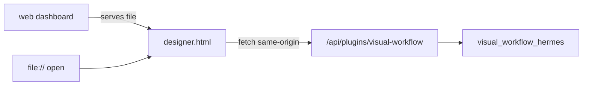

# Standalone Widget

`widgets/designer.html` is the entire canvas as one dependency-free HTML file: no build step, no
imports, no framework, no webfont. It is what the web dashboard tab serves, what
`/workflow new` points at through a `::preview{file=...}` hint, and what a developer can open
directly to inspect the canvas without a host.

- File: `widgets/designer.html`
- Contract: dependency-free, enforced by `tests/test_widget.py`
- API base: `/api/plugins/visual-workflow`, same-origin fetch

## Why a single file

The web dashboard serves plugin frontends as static assets; there is no bundler in that path and
adding one would mean shipping a build artifact that can drift from source. One file that the
host can serve verbatim is the smallest thing that works in every surface, including a bare
`file://` open.

## What it shares with the Desktop canvas

The widget is a copy of the same vanilla engine:

- the same CSS variables (`--vw-*`) with host-theme fallbacks, including note tints mixed from a
  fixed hue and the host card colour;
- the same node vocabulary (`KINDS`, `PALETTE`, note colours) and layout constants;
- the same edge identity (`JSON.stringify([from, to])`), drawing, drag/link behavior, and
  cycle prevention;
- the same cron helpers (`buildCron`, `cronFieldOk`, `cronProblem`, `describeCron`, `presetOf`,
  `timeOf`, `weekdayOf`);
- the same inspector fields and tooltip keys;
- the same three views (Designer, Runs, Schedules).

Parity is not assumed: `tests/test_canvas_ui.py` executes the shared helpers from this file as
well as the Desktop copy and the dashboard bundle, and `tests/test_tooltips.py` requires every
tooltip key in all copies.

## What differs

| Aspect | Widget | Desktop plugin |
| --- | --- | --- |
| Transport | `window.fetch(url, {credentials: "same-origin"})` | `ctx.rest(path, opts)` |
| Mount | `document.getElementById("app")` on load | React ref callback into a host element |
| Theme | Host page CSS variables | Host app tokens with fallbacks |
| Routing | None; it is one page | `/workflows` route plus sidebar row |
| Session | Same-origin dashboard session | Host-authenticated REST door |

The widget does not know about a session token. In the dashboard it relies on the same-origin
session; opened as a bare file it has no server and must fail with a readable error rather than
pretending to save.

## API calls

All calls target a single `API` constant and use the same payload shapes as the Desktop copy:

| Call | Method | Body |
| --- | --- | --- |
| `/designs` | GET | — |
| `/designs/templates` | GET | — |
| `/designs/{name}` | GET | — |
| `/designs/{name}` | POST | `{graph}` |
| `/designs/{name}/validate` | POST | `{graph}` |
| `/designs/{name}/run` | POST | — |
| `/runs/{id}/respond` | POST | `{run_id, node_id, answer}` or `agent_generate` |
| `/runs/{id}/retry` | POST | — |
| `/schedules` | GET | — |
| `/designs/{name}/schedule` | POST | `{preset, time, weekday, cron}` |

These are the same routes documented in [Dashboard API](dashboard-api.md); the widget adds no
server behavior.

## Editing rules

1. **Keep it dependency-free.** No `<script src>`, no CDN, no import maps. The test enforces it.
2. **Change all copies together.** A helper fixed here but not in `desktop/plugin.js` will drift
   back on the next copy; the parity tests exist to catch that.
3. **Keep the tooltip table complete.** A missing key renders a literal `undefined` title.
4. **Do not add a second API base.** A configurable base invites a deployment where the canvas
   silently points at the wrong host.

## Related documentation

- [Canvas Core](canvas-core.md) — the engine this file copies
- [Dashboard API](dashboard-api.md) — the routes it calls
- [Build and Packaging](../repo-operations/build-and-packaging.md) — how the file ships as a
  data file in an installed wheel
