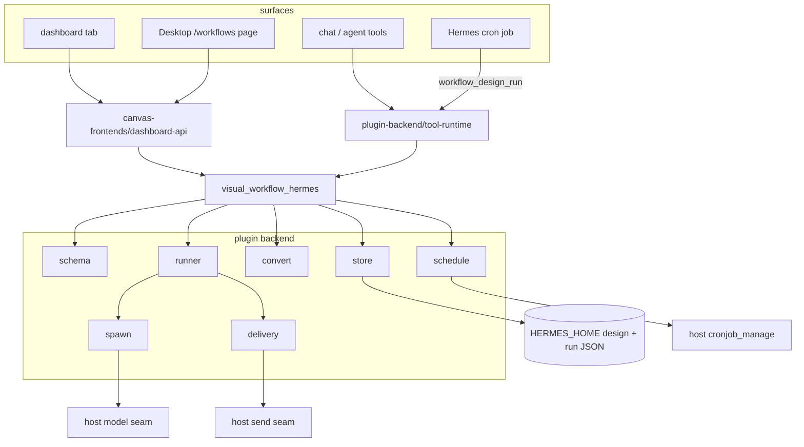

# Hermes Workflow — Overview

A Hermes plugin that adds a visual agent-workflow designer: five node kinds on a canvas, executed
by a plugin-owned sequential runner. Designs are plain JSON, runs are resumable state on disk,
and agent steps execute through the host's own model seams — never through a second scheduler or
a background thread.

## What it is

| Piece | Role |
| --- | --- |
| Canvas (three copies) | Drag-and-drop editor for trigger, agent, condition, approval, and output nodes, plus sticky notes |
| `/workflow` command | Create, list, open, save, validate, run, approve from chat |
| Five tools | `workflow_design_{save,load,validate,run,respond}` for the agent |
| Dashboard API | REST routes the web and Desktop canvases call |
| Runner | Sequential, resumable execution with gates, retries, deadlines, and delivery |
| Scheduler | Recurring runs as real Hermes cron jobs, never an in-process timer |

The working docs are [README.md](../README.md) and [SKILL.md](../SKILL.md) in the repository root;
this wiki is the code-level companion.

## End-to-end architecture



## A run, in order

1. The graph is validated by
   [schema validation](plugin-backend/schema-validation.md) — one trigger, unique ids, known
   kinds, acyclic edges, bounded retries and deadlines.
2. [Run plan conversion](plugin-backend/run-plan-conversion.md) drops the trigger and notes and
   orders the remaining steps with a stable topological sort.
3. The [sequential runner](plugin-backend/sequential-runner.md) advances a JSON state from step to
   step, persisting after each one.
4. An agent step runs through the injected spawn seam: `ctx.subagent_lifecycle` from chat, the
   host `PluginLlm` facade from the web ([agent spawn](plugin-backend/agent-spawn.md)).
5. An approval step parks the run until a human answers; an expired gate fails instead of waiting
   forever.
6. An output step collects upstream results and optionally hands them to
   [delivery](plugin-backend/delivery-and-channels.md), recording a receipt whether the send
   succeeds or fails.
7. The run finishes `done`, `failed`, or paused at `awaiting_approval` / `awaiting_agent`; the
   canvases and chat can all resume it.

## Repository map

| Path | What lives there |
| --- | --- |
| `visual_workflow_hermes/` | The plugin package: schema, store, convert, runner, spawn, host catalogs, delivery, scheduling, runtime, registration |
| `dashboard/plugin_api.py` | FastAPI router mounted at `/api/plugins/visual-workflow` |
| `desktop/plugin.js` | Desktop page, routes contribution, and the canvas |
| `dashboard/dist/index.js` | The web dashboard's canvas (served tab), kept in sync with the other copies |
| `widgets/designer.html` | Dependency-free standalone canvas used by chat previews and manual checks |
| `examples/*.designer.json` | Four starting templates, all validated by tests |
| `tests/` | 400+ pytest cases: schema, store, converter, runner, routes, canopies, probes |
| `.hermes/` | Developer live probes and repair scripts — not shipped |

## Core module documentation

- [Plugin Backend](plugin-backend.md) — the execution engine
  - [Schema Validation](plugin-backend/schema-validation.md)
  - [Design and Run Store](plugin-backend/design-and-run-store.md)
  - [Run Plan Conversion](plugin-backend/run-plan-conversion.md)
  - [Sequential Runner](plugin-backend/sequential-runner.md)
  - [Agent Spawn](plugin-backend/agent-spawn.md)
  - [Host Catalogs](plugin-backend/host-catalogs.md)
  - [Delivery and Channels](plugin-backend/delivery-and-channels.md)
  - [Scheduling](plugin-backend/scheduling.md)
  - [Tool Runtime](plugin-backend/tool-runtime.md)
  - [Plugin Entry](plugin-backend/plugin-entry.md)
- [Canvas Frontends](canvas-frontends.md) — the three surfaces and the API between them
  - [Dashboard API](canvas-frontends/dashboard-api.md)
  - [Canvas Core](canvas-frontends/canvas-core.md)
  - [Canvas Inspector](canvas-frontends/canvas-inspector.md)
  - [Canvas Runs and Schedules](canvas-frontends/canvas-runs-schedules.md)
  - [Canvas Design Lifecycle](canvas-frontends/canvas-design-lifecycle.md)
  - [Standalone Widget](canvas-frontends/standalone-widget.md)
- [Repo Operations](repo-operations.md) — packaging, CI, deployment, probes
  - [Build and Packaging](repo-operations/build-and-packaging.md)
  - [Live Probes](repo-operations/live-probes.md)
- [Testing](testing.md) — what each test file pins, and what the suite cannot prove

## Invariants worth knowing before changing code

1. **Five node kinds plus note, never a sixth.** The schema, the validator, every canvas, and the
   runbook pin this. Edges are `after`; `x`/`y` are widget-only.
2. **Nothing runs on a timer.** There is no background thread. Recurring runs are real Hermes
   cron jobs created through `cronjob_manage`.
3. **Host seams are optional and lazy.** `profiles`, `models`, `spawn`, `delivery`, and the
   scheduler import host modules inside calls and degrade to "absent". Keep that pattern.
4. **Canvas payload shapes are contracts.** The tests drive every surface with the exact JSON the
   GUI builds; changing a field name means changing all three copies, `node-spec.json`, and the
   schema in the same commit.
5. **A failed delivery does not fail the run.** It is recorded in `deliveries` with `ok: false`;
   read the receipt before claiming a message was sent.
6. **Approvals are answered only through the host's release path.** A scheduled run never answers
   a human gate.
7. **Untrusted input is re-validated.** Chat and webhook text goes through the schema before a
   write; store paths stay confined under the store root.

## Quick start for a contributor

```bash
.venv/bin/pytest                 # full suite, pure Python
hermes plugins validate .        # manifest and registration gates
hermes plugins doctor .          # real runtime contracts, reports tool count
```

Route tests skip silently without `fastapi`/`httpx`; run them for real with:

```bash
uv run --isolated --no-project --with pytest --with fastapi --with httpx pytest tests/test_dashboard.py
```

After a change that runs in the host, sync `~/.hermes/plugins/visual-workflow`, toggle the plugin
so it rebuilds, and run one live probe (see [Build and Packaging](repo-operations/build-and-packaging.md)).
