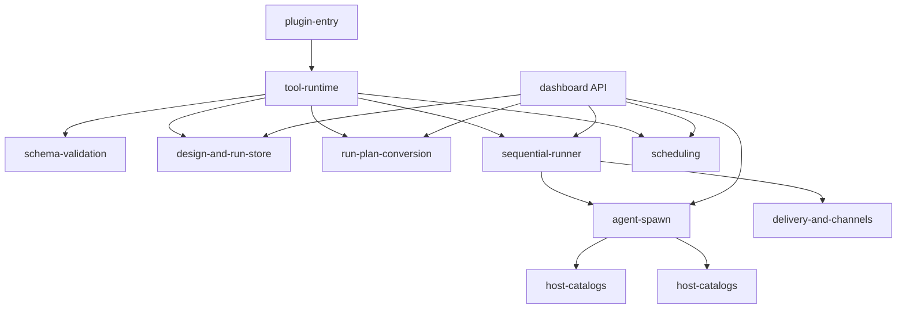
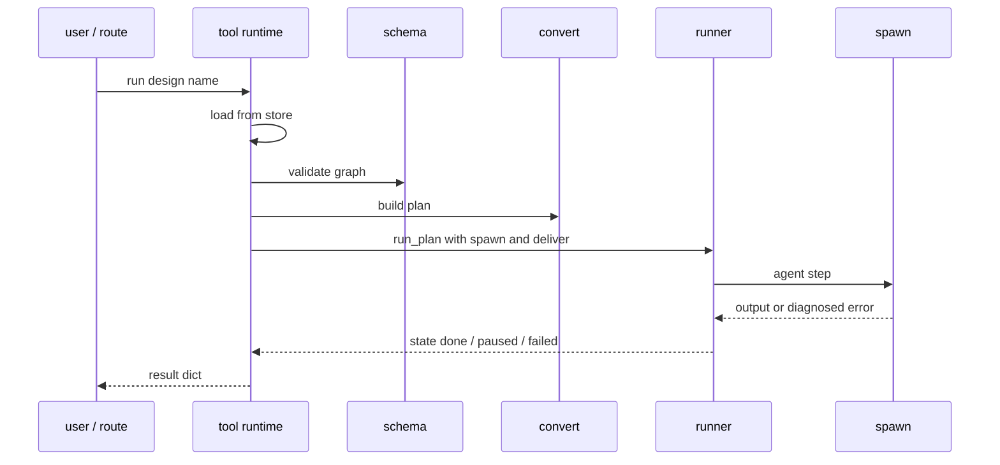

# Plugin Backend

The Python package `visual_workflow_hermes` is the plugin's engine. It is deliberately layered:
pure data rules at the bottom, orchestration in the middle, host adapters at the edges. Nothing in
the middle needs a host to run, which is why the whole engine is unit-testable and why the chat
tools and the web routes share exactly one implementation.

## Layers

| Layer | Modules | Depends on host? |
| --- | --- | --- |
| Pure rules | [Schema Validation](plugin-backend/schema-validation.md), [Run Plan Conversion](plugin-backend/run-plan-conversion.md), [Scheduling](plugin-backend/scheduling.md) helpers | no |
| State | [Design and Run Store](plugin-backend/design-and-run-store.md) | only `$HERMES_HOME` |
| Execution | [Sequential Runner](plugin-backend/sequential-runner.md) | no (seams injected) |
| Host adapters | [Agent Spawn](plugin-backend/agent-spawn.md), [Host Catalogs](plugin-backend/host-catalogs.md), [Delivery and Channels](plugin-backend/delivery-and-channels.md), [Scheduling](plugin-backend/scheduling.md) cron seam | yes, lazily and failure-tolerantly |
| Orchestration | [Tool Runtime](plugin-backend/tool-runtime.md), [Plugin Entry](plugin-backend/plugin-entry.md) | via the injected `ctx` |

## The shape of a run

Every persisted transition goes through the same `RunStore.save`, which is why a run started in
chat is visible in the canvas and resumable from either surface.

## Design invariants

1. **One validator.** `DesignStore.save` revalidates; the route and tool do not each invent their
   own rules.
2. **One converter.** Trigger and note nodes never become steps; edges that name them are
   stripped so hand-written JSON cannot smuggle a phantom dependency.
3. **One runner.** Chat and web differ only in the `spawn` and `deliver` seams they inject.
4. **Failure is data.** Store, delivery, scheduler, and catalog problems return values with
   `ok: false` or `available: false`; they do not raise through a tool dispatcher or a route.
5. **Host seams are optional.** Host imports happen inside calls and degrade to "absent", so the
   package imports in tests and plain tooling.

## Documentation map

- [Schema Validation](plugin-backend/schema-validation.md) — the rulebook
- [Design and Run Store](plugin-backend/design-and-run-store.md) — persistence
- [Run Plan Conversion](plugin-backend/run-plan-conversion.md) — graph to steps
- [Sequential Runner](plugin-backend/sequential-runner.md) — execution and resume
- [Agent Spawn](plugin-backend/agent-spawn.md) — model calls from the web
- [Host Catalogs](plugin-backend/host-catalogs.md) — profiles and models
- [Delivery and Channels](plugin-backend/delivery-and-channels.md) — outbound messages
- [Scheduling](plugin-backend/scheduling.md) — cron jobs
- [Tool Runtime](plugin-backend/tool-runtime.md) — chat command and tools
- [Plugin Entry](plugin-backend/plugin-entry.md) — registration
