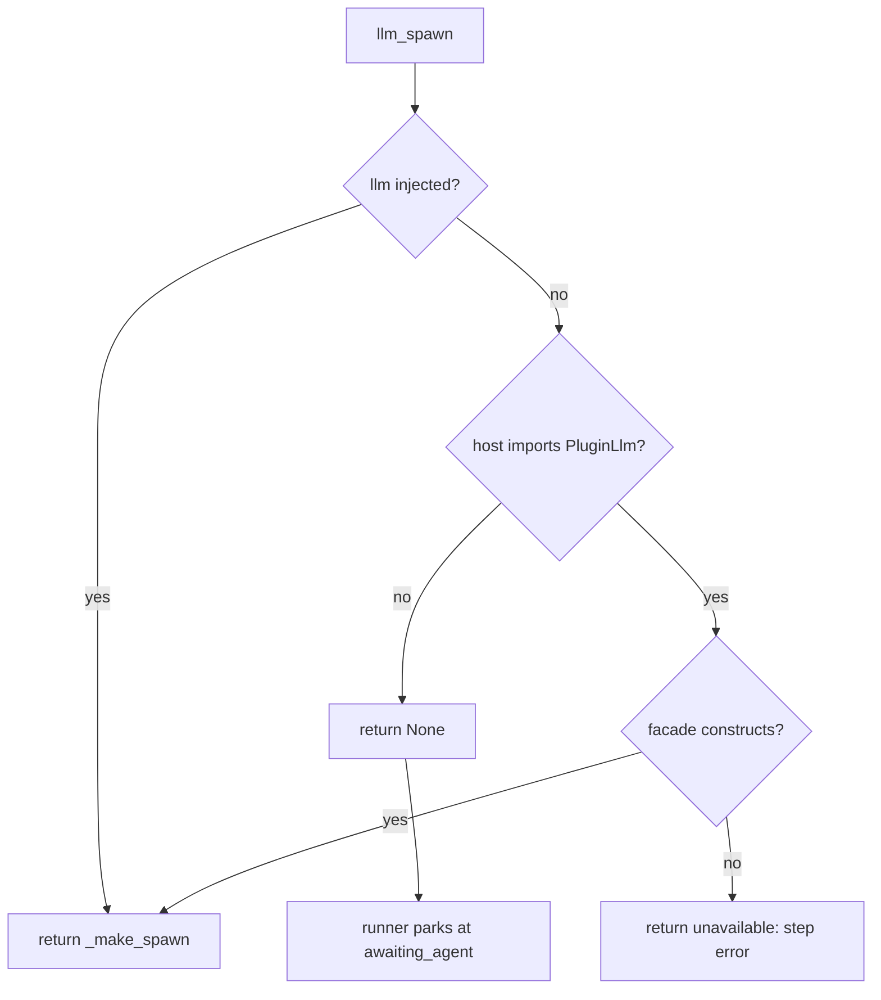

# Agent Spawn

The adapter between the runner's `spawn` seam and the host's own way of running a model call.
There are two host-owned performers, and they are used from different contexts:

| Context | Seam | Why |
| --- | --- | --- |
| Chat (`/workflow run`, `workflow_design_run`) | `ctx.subagent_lifecycle` | A full child agent bound to the active parent session; the chat has one |
| Web canvas (`POST /designs/{name}/run`) | `PluginLlm` facade | The web server never has a parent session; the facade needs none |

This module owns the **web** side. The chat-side adapter lives in
[`runtime._subagent_spawn`](tool-runtime.md); both produce the same contract:
`spawn(step, outputs, run) -> {"output", "structured"?, "error"?}`.

- Source: `visual_workflow_hermes/spawn.py`
- Entry point: `llm_spawn(llm=None, plugin_id="visual-workflow")`

## Failure-tolerant construction



Returning `None` is reserved for "this host has no facade at all" (unit tests, plain tooling,
an older host): the runner then parks at `awaiting_agent`, exactly as it did before the facade
existed. A host that *is* present but fails to construct the facade must not park the run
forever, so that case returns a spawn that reports an explicit `agent backend unavailable`
step error.

Importing this module never imports host code at top level. Every host access is inside the
call, wrapped, and degrades — the same discipline as `profiles.py` and `models.py`.

## What a step may override

```python
overrides = {"model": model or None, "timeout": step.get("timeout"), "purpose": audit}
```

- **Only a model override is requested.** The host routes the provider from the model id. A
  `provider` is not part of the design contract, and sending one would trip the host's
  fail-closed `allow_provider_override` trust gate.
- The model comes from [`profiles.step_model`](host-catalogs.md): the node's own `model` wins,
  then its profile's model, then the host default.
- `purpose` is an audit string `workflow:<run_id>:<node_id>`, so a host log can attribute the
  call to one workflow step.
- `timeout` is passed through per step.
- When the step carries a JSON `schema`, the facade's `complete_structured` is used and the
  parsed object is returned as `structured`; otherwise `complete` returns plain text.

## Failure diagnosis

`diagnose_failure(exc)` maps a backend exception to `{kind, why}` for six known surfaces, and
returns `{}` for anything else so the run records the raw message instead of inventing a reason.

| Kind | Signals | Advice carried in `why` |
| --- | --- | --- |
| `trust refusal` | `PluginLlmTrustError` / a `PermissionError` naming an `allow_` flag or plugin override | clear the step's model, or enable the override flag |
| `auth failed` | 401, 403, "api key", "unauthorized", "authentication" | check that provider's key in the host config |
| `unknown model` | "does not exist", "not found", "decommissioned" | fix the step's Model field |
| `rate limited` | "rate limit", 429, "too many requests", "quota" | wait a minute and rerun |
| `timed out` | "timed out", "timeout", "deadline" | rerun, or give the step more time |
| `connection problem` | connection, ECONNREFUSED, getaddrinfo, reset by peer, unreachable | a retry often clears it |

Ordering is deliberate. Auth is checked before "not found" because "api key not found" contains
both; a filesystem `PermissionError` is not a trust refusal, so the trust check requires the
distinctive signal rather than every `PermissionError`.

The returned record is:

```json
{
  "error": "rate limited: 429 Too Many Requests — the model provider asked to slow down...",
  "error_kind": "rate limited",
  "error_hint": "the model provider asked to slow down — wait a minute and rerun"
}
```

`_explain` keeps the original exception text first, then the advice. The runner stores `kind`
and `hint` with the failure and the canvases render the kind as a chip whose tooltip is the hint.

## Prompt and context assembly

For a structured call the instructions are the step's `prompt` and the upstream context is
passed as one text input. For a plain call the context is appended to the prompt as text. Both
paths add a fixed system prompt: "You are one step of an agent workflow; follow the instructions
exactly." Context rendering and truncation are owned by `runner.render_context`, so the two
spawn implementations cannot format upstream output differently.

## Related documentation

- [Sequential Runner](sequential-runner.md) — consumes this seam
- [Host Catalogs](host-catalogs.md) — `step_model` and provider inference
- [Tool Runtime](tool-runtime.md) — the chat-side spawn
- [Dashboard API](../canvas-frontends/dashboard-api.md) — where the facade is invoked
