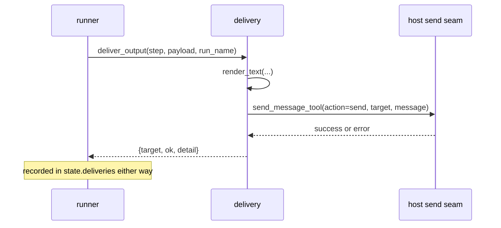

# Delivery and Channels

The outbound half of an output node: turning a collected payload into a short message and
handing it to the host's own send seam, plus the read-only channel directory the canvas uses to
offer valid targets.

- Sources: `visual_workflow_hermes/delivery.py`, `visual_workflow_hermes/channels.py`, `visual_workflow_hermes/hooks.py`
- Delivery never opens a platform socket itself, and a failed delivery never fails the run.

## Two modules, one flow



`channels.py` only *reads* what the gateway has discovered; it never sends.

## Modes

| `deliver` | Target | Meaning |
| --- | --- | --- |
| absent/empty | — | collect only; nothing is sent |
| `notification` | `telegram` | that platform's home channel, resolved by the send seam from `<PLATFORM>_HOME_CHANNEL` |
| `channel` | `telegram:123456`, `slack:#ops` | one specific chat |

Hermes has no OS notification API, so "notify me" is exactly a DM to the platform's home channel.
The canvas derives the mode from the target value rather than asking twice: a bare platform is a
notification, anything containing `:` is a channel. That makes an invalid mode/target pair
impossible to build in the UI, though the validator still checks it for hand-written JSON.

## Rendering

`render_text(run_name, node_id, payload)` produces:

```
Workflow <name> — <node_id>

- <key>: <value>
```

- strings are shown verbatim, other JSON is serialised, and a non-serialisable object falls back
  to `str()` — this function is documented as never raising;
- an empty payload says `(no upstream output)`;
- output is capped at `MAX_TEXT = 4000` characters with an ellipsis. The seam chunks longer text
  anyway; the cap keeps one notification readable.

## Sending

`send_text(target, text)` imports `tools.send_message_tool.send_message_tool` lazily — the same
non-model entry point the `hermes send` CLI and the cron scheduler use. It is deliberately not an
agent-callable tool; the plugin is a caller, not a tool surface.

Failure is data:

| Situation | Receipt |
| --- | --- |
| host module not importable (tests, plain tooling) | `{ok: false, detail: "host send seam unavailable: ..."}` |
| seam raises | `{ok: false, detail: "send failed: ..."}` |
| seam returns a dict with `success: true` | `{ok: true, detail: note or "sent"}` |
| seam returns plain text instead of JSON | that text is kept as the error detail |
| generic refusal | `{ok: false, detail: error or "send failed"}` |

`deliver_output` adds two pre-flight checks: a missing target and a `channel` target without `:`
are refused with a specific sentence rather than being handed to the seam.

## Model-initiated sends ask first

The host keeps its send function away from the model, and two tool calls could otherwise walk
around that: `workflow_design_save` storing a delivering design, then `workflow_design_run`
sending through it. `hooks.py::on_pre_tool_call` closes the loop. It scans the design with
`delivering_targets(design)` — a pure function returning every output node whose `deliver` is
set — and only when that set is non-empty does it return the host's `approve` escalation
naming each target. The text itself does not exist yet — it will be whatever the run's
agent steps produce, and the prompt says so. Collect-only designs and unknown names return
`None` (pass-through), so ordinary runs never see a prompt, and human paths (slash commands, the canvas
routes) never pass through model-tool dispatch at all.

The prompt alone is not the whole gate: `tool_run` stamps the run record with
`approved_targets` at every human-attended start, and `tool_respond` refuses a resume whose
design's current delivering set is not a subset of the stamp. Editing a saved design mid-run
to add a target therefore cannot smuggle a send through the resume path — see
[Tool Runtime](tool-runtime.md).

## Channel directory

`list_delivery_targets(home=None)` reads the gateway's `channel_directory.json` (or the host's
`gateway.channel_directory.load_directory`, which re-applies aliases and session discovery) and
returns:

```json
{"id": "telegram:8522302999", "label": "Ada · telegram", "kind": "dm", "platform": "telegram"}
```

- `local`, `api_server`, and `webhook` are skipped: they appear as platform keys but are not
  messaging targets.
- A platform's home channel is offered **only after** discovery found at least one real chat on
  it. A stale platform key with no configured bot must not advertise a target that cannot be
  reached.
- An explicit `home` argument is authoritative: a caller asking for a profile-scoped directory
  must not silently get the process-global one.

`list_host_channels` wraps that in `{channels, available}` and turns any unexpected error into
"no channels", never a 500.

## Reading receipts

A run result carries one receipt per output that attempted delivery:

```json
{"node_id": "out", "target": "telegram:123", "ok": false, "detail": "chat not found"}
```

Both canvases and the chat description show `sent`/`FAILED` per node. The run still ends
`done`; only the receipt says the message did not arrive. Never report a delivery as succeeded
without reading that receipt.

## Related documentation

- [Sequential Runner](sequential-runner.md) — records the receipts
- [Host Catalogs](host-catalogs.md) — the same failure-tolerant pattern
- [Schema Validation](schema-validation.md) — `deliver`/`target` rules
- [Tool Runtime](tool-runtime.md) — the `approved_targets` stamp the gate relies on
- [Canvas Inspector](../canvas-frontends/canvas-inspector.md) — the send-to picker
