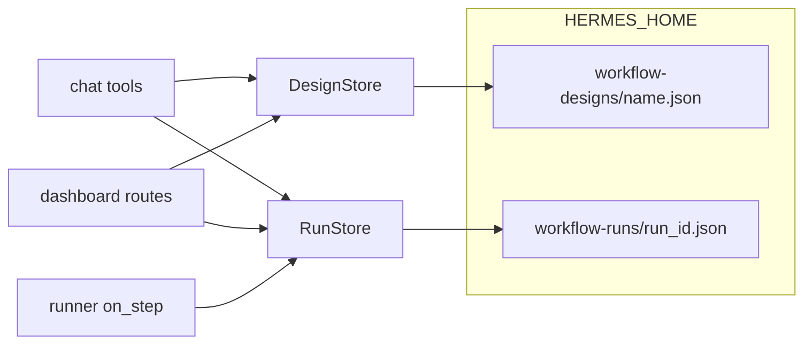
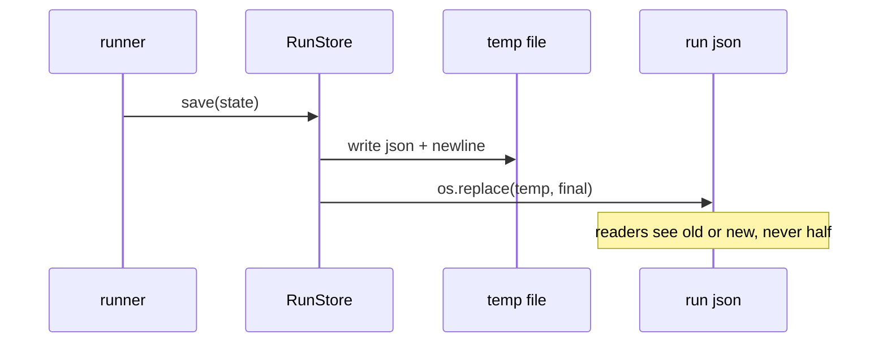

# Design and Run Store

On-disk persistence for two different things: saved designer graphs (the source a user edits)
and run state (the execution record that must survive a pause, a restart, or a browser reload).
Both live under the Hermes home, are written atomically, and enforce their filename rules so a
caller can never address a path outside the store root.

- Source: `visual_workflow_hermes/store.py`
- Classes: `DesignStore`, `RunStore`
- Location: `$HERMES_HOME/workflow-designs/<name>.json` and
  `$HERMES_HOME/workflow-runs/<run_id>.json`

## Why two stores

Designs are user-owned, long-lived, and addressed by a human-chosen name. Runs are
machine-owned, short-lived, and addressed by a generated id. They have different validation,
different naming rules, and different read patterns (the canvas lists every run, but saves one
design at a time), so they are separate classes with separate roots rather than one generic
JSON store.

## DesignStore

| Member | Contract |
| --- | --- |
| `__init__(root=None)` | Defaults to `$HERMES_HOME/workflow-designs`, creates it |
| `_path(name)` | Enforces `^[a-z0-9][a-z0-9_.-]{0,63}$`; raises `ValueError` otherwise |
| `save(name, graph)` | Re-validates the graph, then writes atomically; returns the path |
| `load(name)` | Returns the parsed graph, or raises `FileNotFoundError` / `ValueError` |
| `list_designs()` | Sorted stems of `*.json` |

Names are restricted deliberately: the name becomes a filename, so allowing `../` or an
absolute path would be a path-traversal bug. A non-string name (JSON is untyped) is a
`ValueError`, not a `TypeError` from the regex, because callers document and catch `ValueError`.

`save` calls `validate_designer_graph` again even though the dashboard route already did. That
is intentional: the store is also reachable from the chat tool and from tests, and a store that
writes arbitrary JSON would eventually be used by something that forgot to validate.

`load` distinguishes "missing" from "corrupt": a missing file is `FileNotFoundError`, while an
unreadable or unparseable file is a `ValueError` naming the design. Routes map the first to 404
and the second to 400.

## RunStore

Run ids are generated as `uuid4().hex[:12]`, and `_path` enforces `^[a-f0-9]{6,32}$` so a
hand-written tool argument cannot escape the root.

| Member | Contract |
| --- | --- |
| `save(state)` | Requires a valid string `run_id`; raises `ValueError` otherwise |
| `load(run_id)` | Parsed state; `FileNotFoundError` or `ValueError` |
| `list_runs()` | Sorted stems |
| `recent(limit=20)` | Newest-first `[{run_id, updated, state}]`, skipping unreadable files |

`recent` is what makes the Runs view honest: it reads every file on disk, not just runs this
browser started, so a run begun by chat or by a cron job is visible and answerable in the
canvas. A half-written or corrupt file is skipped rather than crashing the list; a file whose
JSON lacks a string `status` is not a run and is omitted.

## Atomic writes

`_write_json` writes to a temporary file in the destination directory and then `os.replace`s it
into place. This matters because the canvas polls run state while the runner saves after every
step. A `write_text` would truncate before streaming, so a concurrent read could observe an
empty or partial file. The temp file shares the destination directory to keep `os.replace`
atomic on one filesystem, and any failure unlinks the temp file before re-raising.

## Error contract

Both stores promise `ValueError` for a bad name/id and for corrupt content, and
`FileNotFoundError` for a missing file. Callers rely on this narrow set:

- `runtime.tool_*` catches `(FileNotFoundError, ValueError)` and turns them into
  `{"ok": false, "error": ...}`.
- `dashboard/plugin_api.py` maps `FileNotFoundError` to 404 and `ValueError` to 400.
- The runner's `on_step` callback is `RunStore.save`; a write failure propagates as a run
  failure rather than leaving the run silently unpersisted.

## Related documentation

- [Schema Validation](schema-validation.md) — the rulebook `DesignStore.save` reapplies
- [Sequential Runner](sequential-runner.md) — what writes into `RunStore`
- [Tool Runtime](tool-runtime.md) — how tool handlers translate store errors
- [Dashboard API](../canvas-frontends/dashboard-api.md) — HTTP mapping of the errors
