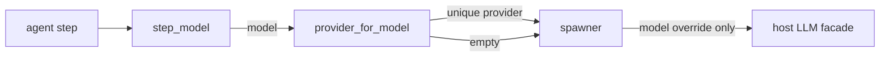

# Host Catalogs

Thin, failure-tolerant views of two host registries the canvas needs to make agent nodes
usable: the **profiles** (bots) a design can run as, and the **models** the host can route.

- Sources: `visual_workflow_hermes/profiles.py`, `visual_workflow_hermes/models.py`
- Return shapes are the canvas contract, not the host's raw payload.

Both modules follow the same discipline: nothing host-specific is imported at module scope, and
every failure degrades to "nothing listed" plus an availability flag rather than an exception.
That is what lets the dashboard router and the unit tests import where the host package is
absent.

## Profiles

`list_host_profiles()` returns `[{name, label, model, is_default, description}]` from
`hermes_cli.profiles.list_profiles(lazy_skill_count=True)`. A record without a name is skipped;
the label falls back from bot title to display name to the raw name.

`profile_choice(name, profiles=None)` returns the matching record or `None`. A non-string name
is "no choice", not a crash — JSON is untyped, and `{"profile": 5}` must not raise an
`AttributeError` out of a picker's helper.

`step_model(step, profiles=None)` resolves the model for an agent step:

1. the node's own `model`, when it is a non-empty string;
2. otherwise the chosen profile's `model`;
3. otherwise `None`, which leaves the host's default in place.

A profile whose model is missing or blank yields `None` rather than an empty override.

> **Limitation (v1, deliberate):** choosing a profile chooses the *model* an agent step runs on.
> A subagent still executes inside the host profile serving the request — the launch request has
> no profile/home field — so a workflow cannot re-home a step to another profile's skills, SOUL,
> or channels.

## Models

`list_host_models(refresh=False)` reads the same catalog that backs the host's model picker and
normalises it to:

```json
{
  "providers": [{"slug": "openai", "label": "OpenAI", "models": ["gpt-..."]}],
  "available": true,
  "current": {"model": "...", "provider": "openai"}
}
```

`_read_catalog` accepts the host's payload defensively: a non-dict reply, a non-dict provider
row, a dict model entry instead of a string, and duplicates are all tolerated. A provider with
no slug or no models is dropped.

### Cache

A cold catalog build can probe providers, so the module keeps a process-local cache with a
60-second TTL:

- `list_host_models` returns a **deep copy** every time. The cache is shared process-wide; a
  caller that mutated the payload would otherwise poison the catalog for every route until the
  TTL expired.
- `clear_cache()` drops it; the route exposes that as `GET /models?refresh=1`.

### Provider inference

`provider_for_model(model, catalog=None)` answers "which provider serves this id":

- no hits → `""` (let the host's own default routing decide);
- exactly one hit → that slug;
- several hits → the host's current provider when it is one of them, else `""`.

Returning `""` on ambiguity is intentional. Guessing a provider is how a model/provider pair the
host rejects gets constructed; an empty answer leaves routing to the host.



## Canvas behaviour when a catalog is absent

| Endpoint | Empty result | Canvas fallback |
| --- | --- | --- |
| `GET /profiles` | `{"profiles": [], "available": false}` | profile select shows "no profiles listed" |
| `GET /models` | `{"providers": [], "available": false}` | model field becomes free text |
| `GET /channels` | `{"channels": [], "available": false}` | target field becomes free text |

A saved value that the catalog no longer lists is kept visible in the picker as "(not found)" or
"(not listed)" so opening the inspector cannot silently retarget a step.

## Related documentation

- [Agent Spawn](agent-spawn.md) — the consumer of `step_model`
- [Delivery and Channels](delivery-and-channels.md) — the channel picker's backend
- [Dashboard API](../canvas-frontends/dashboard-api.md) — the HTTP routes
- [Canvas Inspector](../canvas-frontends/canvas-inspector.md) — the pickers
