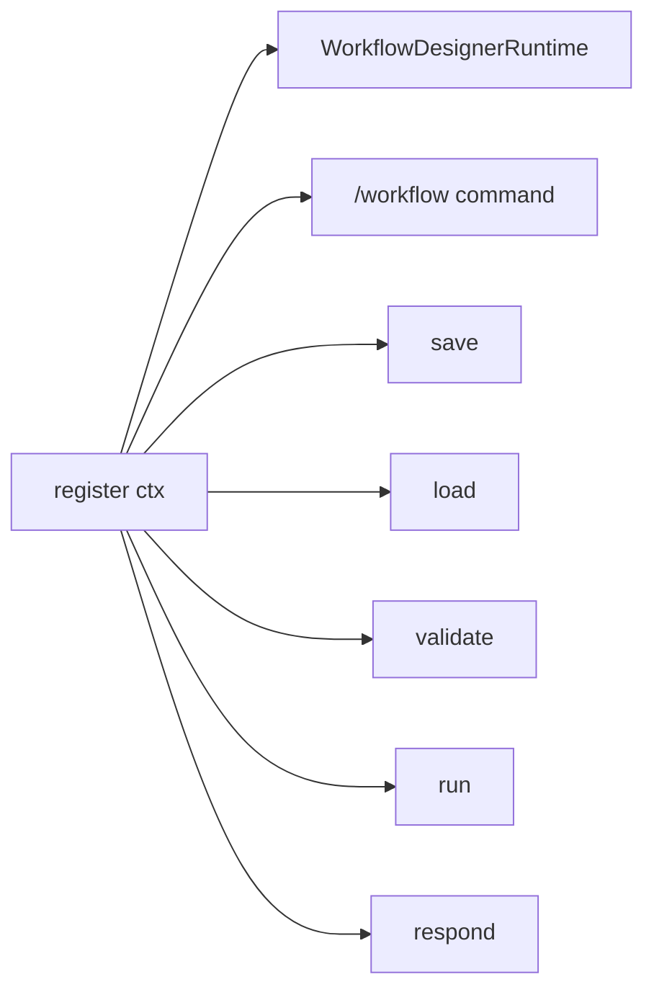

# Plugin Entry

The module the host imports to load the plugin. It owns the registration glue and the five tool
schemas — nothing else. All behaviour lives in [`runtime.py`](tool-runtime.md); keeping the entry
point thin is what lets the rest of the package be imported and tested without a host context.

- Source: `visual_workflow_hermes/__init__.py`
- Entry point: `register(ctx) -> None`
- Toolset: `visual-workflow`

## What is registered



- one slash command: `workflow`, described as
  `/workflow [new|list|open|save|validate|run|approve]`;
- five tools: `workflow_design_save`, `workflow_design_load`, `workflow_design_validate`,
  `workflow_design_run`, `workflow_design_respond`.

The manifest `plugin.yaml` declares the same five names. The host validates that declaration
against the actual `register_tool` calls, so adding a tool means updating both.

## The JSON adapter

`_as_json(handler)` wraps a dict-returning runtime method into the host contract:

```python
def wrapper(args, **kwargs):
    return json.dumps(handler(args, **kwargs))
```

The host dispatcher rejects non-string tool results. Internal callers (slash paths, unit tests)
keep calling the raw `tool_*` methods and get dicts, which keeps tests readable and avoids
double-parsing.

`functools.wraps` preserves the handler's name and docstring on the wrapper.

## Tool schemas

Each schema is an OpenAI-style body `{"name", "description", "parameters"}` passed as the
`schema=` argument of `register_tool`.

| Tool | Required parameters | Notes |
| --- | --- | --- |
| `workflow_design_save` | `name`, `graph` | the graph is validated before writing |
| `workflow_design_load` | `name` | returns the stored graph |
| `workflow_design_validate` | `graph` | returns `{node, field, msg}` defects |
| `workflow_design_run` | `name` | manual run; a scheduled replay uses the same tool |
| `workflow_design_respond` | `run_id`, `node_id` plus `answer` or `structured` | agent-step output only; approval gates are refused |

`workflow_design_respond` uses `anyOf` to require at least one payload field. Without it, a
resume carrying neither could store `None` as the step's output and advance the run — silent
corruption. The runtime also prefers `structured` over `answer` when both are sent.

Descriptions are written for the model, not for a human skimming the manifest: they name the
statuses a run can return and the exact follow-up tool for each.

## What is deliberately absent

There is no `register_status_segment` call: the pinned host (0.22.5) does not expose one, so a
status segment is not attempted. The one hook is `pre_tool_call` ([delivery gate](delivery-and-channels.md));
there is no other middleware. The plugin is a command, five tools, one hook, a dashboard
router, and a desktop page.

## Loading order and imports

`register` imports `runtime` inside the function. The package `__init__` therefore stays cheap to
import for tooling and manifest parsing, and a missing optional host module cannot break plugin
discovery before `register` is reached.

## Related documentation

- [Tool Runtime](tool-runtime.md) — the handlers behind every registration
- [Build and Packaging](../repo-operations/build-and-packaging.md) — `plugin.yaml` gates
- [Sequential Runner](sequential-runner.md) — execution behind `run` and `respond`
