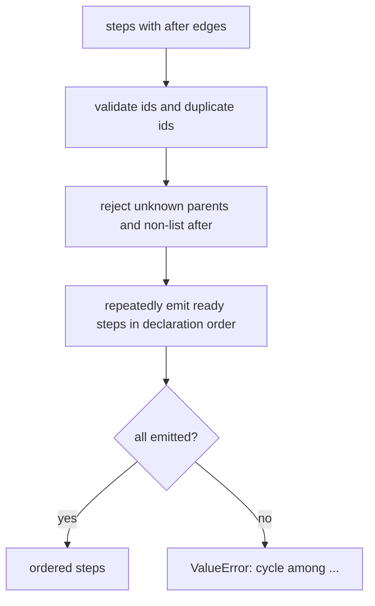

# Run Plan Conversion

The bridge between what a user draws and what the runner executes. `build_run_plan` turns a
designer graph into an ordered list of executable steps, dropping the nodes that are metadata
and proving the result is acyclic and internally consistent.

- Source: `visual_workflow_hermes/convert.py`
- Entry points: `build_run_plan(designer) -> {"name", "steps", "meta"}` and
  `topological_order(steps) -> list[dict]`
- Pure functions: no I/O, no host imports, deterministic for the same JSON.

## Mapping

| Designer node | Plan output |
| --- | --- |
| `trigger` | dropped; recorded in `meta.trigger` (`mode`, `schedule`) |
| `note` | dropped |
| `agent` | `{"kind": "agent", "prompt", ...passthrough}` |
| `condition` | `{"kind": "condition", "expression"}` |
| `approval` | `{"kind": "approval", "question", "options"?, "context"?, "timeout_minutes"?, "on_timeout"?}` |
| `output` | `{"kind": "output", "keys": [<parent ids>], "deliver"?, "target"?}` |
| `x` / `y` | dropped (layout is widget-only) |

Every step keeps `id`, `kind`, and `after`. For an agent step the passthrough keys are
`profile`, `model`, `schema`, `inputs`, `timeout`, and `retries`; a key is copied only when it is
present, so the step JSON stays close to what the user wrote.

An agent step never carries a `provider`: a design names a model, and the runtime derives the
provider from the host catalog. That keeps the canvas to one select and makes a rejected
model/provider pair impossible.

## Notes are not steps

Notes are legal canvas content but never work. The validator already refuses edges to a note;
the converter also strips note ids from every `after` list. That second filter means a
hand-written JSON cannot turn an annotation into a phantom dependency, even if validation was
bypassed.

## Ordering

`topological_order` implements Kahn's algorithm with a stable tie-break: whenever several steps
are ready, they are emitted in their original declaration order. The same designer JSON
therefore always yields the same run order, and the canvas's node order decides.



Three failure modes are loud rather than silent:

- a step without a non-empty string `id`, or with a duplicate id, would drop work from a dict
  comprehension — so it raises;
- a parent that does not exist is a typo, not an edge to ignore; filtering it out would silently
  turn a broken graph into a ready root;
- a cycle raises with the remaining step ids rather than hanging the runner.

## Plan shape

```json
{
  "name": "hello-world",
  "steps": [
    {"id": "writer", "kind": "agent", "after": [], "prompt": "Write a haiku."},
    {"id": "out", "kind": "output", "after": ["writer"], "keys": ["writer"]}
  ],
  "meta": {"trigger": {"mode": "manual", "schedule": ""}, "designer": true}
}
```

`meta.trigger` is informational for the UI and the scheduler; the runner never branches on it.
A design containing only a trigger raises `ValueError` ("no executable nodes"), because running
it would do nothing while looking successful.

## Contracts and consumers

- [`schema.validate_designer_graph`](schema-validation.md) runs first on every real path, so the
  converter usually sees a legal graph; its own checks are defence for hand-written JSON and for
  callers that skipped validation.
- The [runner](sequential-runner.md) consumes `steps` directly and treats `after` as the skip
  propagation graph.
- The [dashboard API](../canvas-frontends/dashboard-api.md) maps a converter `ValueError` to a
  400 with the message, and the tool runtime returns it as an `{"ok": false}` result.
- Scheduling reads the trigger from the original designer, not from `meta`, because
  `schedule_design` may rewrite the trigger's cron before building the plan.

## Tests

`tests/test_convert.py` covers ordering, the trigger/note drops, the agent passthrough list,
the output keys, dangling parents, duplicate ids, and cycles.

## Related documentation

- [Schema Validation](schema-validation.md)
- [Sequential Runner](sequential-runner.md)
- [Agent Spawn](agent-spawn.md)
