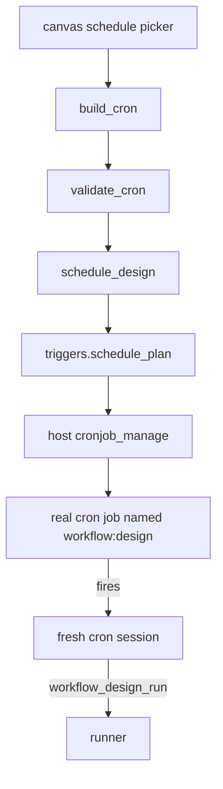

# Scheduling

Recurring runs, implemented as real Hermes cron jobs. A schedule trigger does not start a
background thread in the plugin — nothing here runs on a timer. Instead the plugin creates (or
updates) a host cron job whose prompt tells the fresh cron session to run the saved design
through the plugin's own tools.

- Sources: `visual_workflow_hermes/schedule.py`, `visual_workflow_hermes/triggers.py`
- Host seam: the `cronjob_manage` tool (`tools.cronjob_tools.cronjob`), the same call
  `hermes cron` makes.

## Layers

`build_cron` and `validate_cron` are pure, host-free helpers mirrored in every canvas. The canvas
uses the same preset vocabulary and produces the same expression; the server re-validates it.

## Friendly cron building

Presets: `daily`, `weekdays`, `weekly`, `hourly`, `custom`. `build_cron(preset, time, weekday,
custom)`:

| Preset | Output |
| --- | --- |
| `hourly` | `<minute> * * * *` |
| `daily` | `<minute> <hour> * * *` |
| `weekdays` | `<minute> <hour> * * 1-5` |
| `weekly` | `<minute> <hour> * * <dow>` |
| `custom` | the trimmed expression, validated verbatim |

Times are 24-hour `HH:MM`; `time_parts` raises `ValueError` for anything else. `weekday_index`
maps a day name to cron's 0–7 day-of-week (Sunday is 0), so the canvas and the scheduler agree.

`validate_cron` requires exactly five fields and checks each against its bounds with support for
`*`, `a-b`, lists, and `*/n` (and `a/n`). Step suffixes must be positive integers; a field with
extra `/` segments is rejected.

`describe_cron` renders a human line ("Daily at 09:00", "Weekdays at 09:00", "Every Monday at
09:00") and falls back to `Cron <expression>` for anything it cannot phrase. It never guesses.

## Job identity

Jobs are named `workflow:<design>`. `job_name` and `design_of_job` are the two directions of that
marker; `list_workflow_jobs` filters the host's job list to names carrying it. The design name is
stripped once and used stripped everywhere, so a padded name cannot fail to match its existing
job and create a duplicate.

`_job_view` normalises a host job to the Schedules view's shape: `job_id`, `name`, `design`,
`schedule`, `next_run_at`, `last_run_at`, `last_status`, `state`.

## The replay prompt

A cron job has a schedule and a self-contained prompt; it has no field for "tool name plus
structured arguments". `schedule_plan` therefore builds instructions for a fresh session:

1. call `workflow_design_run` with the design name;
2. while `awaiting_agent`, perform the pending prompt and call `workflow_design_respond`;
3. on `awaiting_approval`, do **not** answer — report the question and stop (a scheduled run
   must never answer a human gate);
4. report the final outputs verbatim.

The design name is embedded with `json.dumps`, not string concatenation. A name containing a
quote, backslash, or newline cannot break the embedded JSON example or smuggle instructions into
a fresh cron session. `enabled_toolsets` is limited to the plugin's own toolset, so the prompt
can only rely on tools that session actually has.

## Create or update

`schedule_design(designer, cron="", deliver="origin")`:

- uses the canvas-chosen `cron` when given, else the trigger's own expression;
- when a cron is given, rewrites the design's trigger copy to `schedule` before building the
  plan, so the saved design and the job cannot disagree;
- finds an existing job for the same design and calls the host's `update`, else `create`;
- returns `{ok, created?, cron, job?}` or `{ok: false, error}`.

`apply_action(action, job_id)` supports `pause`, `resume`, `run`, `remove`. An unknown verb, an
absent scheduler, or a refusal all return `{ok: false, error}`; nothing raises into the router.

## Availability

The host scheduler is optional. Every host call goes through `_cron`, which returns `None` when
the module is missing, the call raises, or the reply is not a JSON object. `list_workflow_jobs`
then returns `{"jobs": [], "available": false}` — the Schedules view states that it could not read
the scheduler instead of pretending there are no jobs.

## Why not webhooks

`trigger_mode` is only `manual` or `schedule`. Hermes inbound webhooks are operator-managed
subscriptions with an HMAC secret that fire an existing cron job; a plugin cannot open a route
of its own. A workflow is still reachable from outside by subscribing to it, but a picker that
recorded a URL nobody listens on would be a dead control.

## Related documentation

- [Run Plan Conversion](run-plan-conversion.md) — reads the trigger from the design
- [Tool Runtime](tool-runtime.md) — `workflow_design_run`, which the cron prompt calls
- [Dashboard API](../canvas-frontends/dashboard-api.md) — the schedule routes
- [Canvas Runs and Schedules](../canvas-frontends/canvas-runs-schedules.md) — the Schedules view
