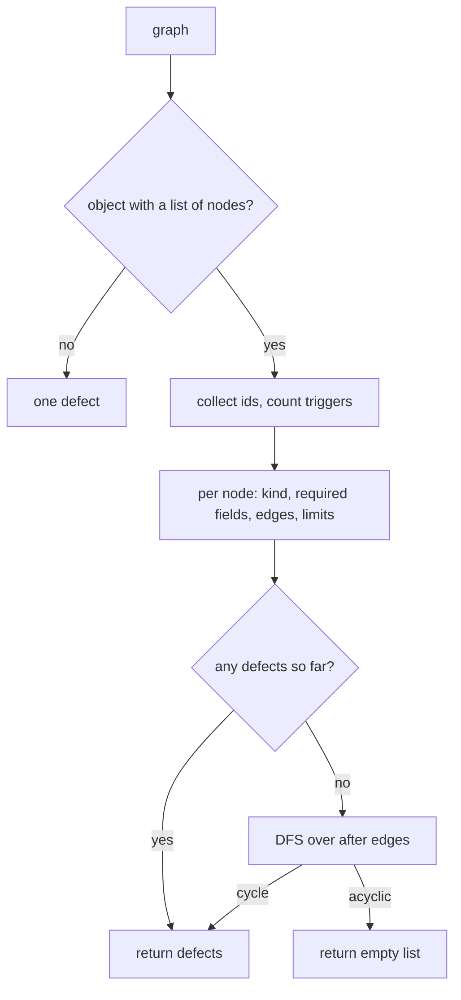

# Schema Validation

The design validator: one pure function that decides whether a designer graph is a legal
workflow before anything is stored or executed. It is the single source of truth for the node
kinds, the graph's structural rules, and the numeric limits, and it is shared by every surface
(the chat tools, the dashboard routes, and the stores) so they cannot disagree about what a
valid design is.

- Source: `visual_workflow_hermes/schema.py`
- Entry point: `validate_designer_graph(graph: dict) -> list[dict]`
- Error shape: `{"node": <id or "">, "field": <name>, "msg": <sentence>}`; an empty list means
  the graph is valid.

## Purpose and scope

A designer graph is plain JSON. It carries a name, a list of nodes, and each node's outgoing
dependencies in `after` (edges point backwards). The validator checks that JSON without any
I/O, without host imports, and without mutating the input, which is why it is also usable from
plain tooling and unit tests.

It deliberately does **not** check anything that belongs to execution: whether a referenced
agent model exists, whether a delivery chat is reachable, or whether the host scheduler is
available. Those are runtime conditions, reported by their own modules.

## The node vocabulary

| Kind | Runs? | Required fields | Notable optional fields |
| --- | --- | --- | --- |
| `trigger` | no (metadata) | `trigger_mode` | `schedule` |
| `agent` | yes | `prompt` | `profile`, `model`, `schema`, `inputs`, `timeout`, `retries` |
| `condition` | yes | `expression` | — |
| `approval` | yes | `question` | `context`, `options`, `timeout_minutes`, `on_timeout` |
| `output` | yes | — | `deliver`, `target` |
| `note` | never | — | `text`, `color` |

`NODE_KINDS` is exactly the five runnable kinds. `NOTE_KIND` (`"note"`) is a sixth legal *canvas*
node but never a step: it has no ports, takes no `after` edges, and is stripped by the plan
builder. Keeping it out of `NODE_KINDS` is what lets every other code path treat "node kind" as
"step kind".

## Rules enforced

1. **Graph shape** — the graph must be an object and `nodes` must be a non-empty list (max 50).
2. **Identity** — every node needs a non-empty string `id`; ids must be unique. A missing or
   non-string id is reported directly instead of surfacing later as an ambiguous `node: ""`
   defect. Because only valid string ids are collected, `set(ids)` cannot raise on an
   unhashable id such as a list.
3. **Exactly one trigger** — zero or several triggers is a defect.
4. **Known kinds** — an unknown `type` is rejected with the accepted vocabulary in the message.
5. **Required payloads** — per the table above, non-empty where the kind cannot run without it.
6. **Edges** — `after` must be a list of strings; each dependency must name an existing node,
   must not be the node itself, and must not be a note. Notes themselves must have no `after`.
7. **Acyclicity** — after the field checks pass, a DFS over `after` reports the cycle path.
8. **Retries** — an agent's `retries` must be a whole number in `0..3`.
9. **Approval deadline** — `timeout_minutes` must be a whole number in `1..4320` (three days);
   `on_timeout` is `reject` or `escalate`.
10. **Delivery** — an output's `deliver` is `notification` or `channel`; either needs a
    non-empty `target`, and a `channel` target must contain `:` (`<platform>:<chat id>`).
11. **Condition grammar** — see below.
12. **Notes' tint** — `color` is one of `yellow`, `blue`, `green`, `red`, or empty.

`_whole_number` exists because a plain `int()` would accept `2.5` (truncated) and `True`
(cast to 1). A malformed count must be rejected, not silently rounded.

## Condition grammar

Conditions may only test an upstream output, in the form:

```
out.<node_id>.<dotted.path> <op> <literal>
```

`<op>` is one of `==`, `!=`, `>`, `>=`, `<`, `<=`. Anything not starting with `out.` is
rejected at design time, so a typo fails in the canvas instead of mid-run.

Node ids may themselves contain dots. Both the validator and the runner resolve a reference by
matching the **longest known id** prefix, so `out.a.b.words > 2` resolves the node `a.b` and the
path `words` rather than the node `a`. The validator additionally rejects a condition that names
a note (a note has no output) or an id that does not exist.

## Validation pipeline



Only graph-shape failures (not an object, non-list nodes, or an empty node list) short-circuit.
Everything else accumulates, so the canvas can show every problem at once instead of making the
user fix them one at a time.

## Consumers and contracts

- [`DesignStore.save`](design-and-run-store.md) re-validates before writing: the store is a
  second line of defence, not a second rulebook.
- [`build_run_plan`](run-plan-conversion.md) assumes a valid graph but still rejects duplicate
  or missing step ids and unknown kinds, because it is also reachable with hand-written JSON.
- The dashboard `POST /designs/{name}` route returns validation defects as a **200** body
  (`{"ok": false, "errors": [...]}`), treating an invalid design as an expected outcome rather
  than a transport error.
- The canvas has its own lightweight mirror of these rules for immediate feedback, but the
  server's verdict is authoritative.

## Limits

| Limit | Value | Why |
| --- | --- | --- |
| Nodes per design | 50 | Keeps a canvas readable and a run bounded |
| Agent retries | 0–3 | A step failing four times is a design defect |
| Approval deadline | 1–4320 minutes | Three days; longer is a design error |
| Trigger modes | `manual`, `schedule` | A webhook is not a plugin-reachable mode |

The webhook mode is absent on purpose: Hermes inbound webhooks are operator-managed
subscriptions that fire an existing cron job; a plugin cannot open a route. A picker recording
a URL nobody listens on would be a dead control.

## Related documentation

- [Design and Run Store](design-and-run-store.md)
- [Run Plan Conversion](run-plan-conversion.md)
- [Sequential Runner](sequential-runner.md)
