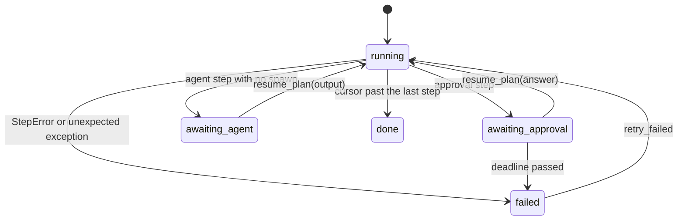

# Sequential Runner

The execution engine. It advances a JSON-serializable state through a run plan one step at a
time, pauses cleanly at approvals and at agent steps that need an external performer, retries
transient agent failures, applies approval deadlines, and records a verdict that survives being
reloaded from disk.

- Source: `visual_workflow_hermes/runner.py`
- Core: `run_plan(plan, state, spawn, on_step, deliver)`,
  `resume_plan(plan, state, answer, ...)`, `retry_failed(plan, state, ...)`
- State: `new_state(plan, run_id)` returns the initial dictionary the rest of the module mutates.

## State machine



The stored state is:

```json
{
  "run_id": "d7b493cae249",
  "name": "hello-world",
  "cursor": 1,
  "status": "running",
  "outputs": {"writer": {"text": "..."}},
  "skipped": [],
  "pending": null,
  "error": null,
  "answers": {},
  "deliveries": [],
  "attempts": {}
}
```

`cursor` is the index of the next step, not the last completed one. Resuming is therefore just
calling `run_plan` again with the same state. `skipped` is a list, not a set, so the whole state
stays JSON-serializable.

## Step semantics

| Kind | Behaviour |
| --- | --- |
| `agent` | Uses `spawn(step, outputs, state)`; with no spawn it parks at `awaiting_agent` with the prompt and rendered context. |
| `condition` | Evaluates the expression; false marks the step skipped and continues. |
| `approval` | Parks at `awaiting_approval` with question, options, context, and `waiting_since`. |
| `output` | Collects `{parent id: output}` under its own id and optionally delivers. |

Skip propagation is transitive: a step whose parent is in `skipped` is skipped too, so a false
condition prunes the whole branch downstream rather than only its immediate child.

An agent step may return `structured` or `output`. The runner checks **key presence**, not
truthiness: an agent that legitimately returns `0`, `false`, or `{}` must not have its payload
replaced by an empty string.

## Conditions

`evaluate_condition` parses `out.<node>.<path> <op> <value>` without `eval`. Parsing, resolution,
and comparison failures are `StepError`s — a design defect — never a silent `False`. Node ids may
contain dots, so the longest known id prefix wins. When the author compared against a number and
the left side is numeric text, the text is coerced for the comparison; a quoted literal keeps
the comparison textual.

## Retries and rate limits

Agent steps retry up to `step["retries"]` (0–3) when the spawn seam reports a failure. Only
agent steps retry: re-asking a human gate is not a retry, and a deterministic condition would
hide its own defect.

A failure diagnosed as `rate limited` gets one extra automatic retry even past the budget, after
`RATE_LIMIT_BACKOFF_SECONDS` (15s). A delay is the one thing that clears a 429; exactly one
extra attempt means a second rate limit is reported instead of napping forever. Inside the
budget a rate-limited attempt also naps before retrying, because an instant retry just re-hits
the cap.

`state["attempts"][node_id]` records how many tries each node took, so a result can explain
itself.

## Pausing, resuming, and deadlines

`pending` is the parked work:

- approval: `{node_id, question, options, context, waiting_since, timeout_minutes?, on_timeout?}`
- agent: `{node_id, prompt, context}`

`resume_plan` validates the answer **before** mutating state: an approval answer must be one of
the offered options, and an agent resume needs a non-`None` answer. A rejected answer therefore
leaves the run resumable instead of half-advanced. The cursor is re-derived from the paused
node's id, not trusted from disk, so editing a design between pause and resume cannot silently
skip or repeat the wrong step.

`check_timeouts` lives on the pending element, not the plan, so a run reloaded after a process
restart still knows its deadline. `escalate` records `detail: "escalation requested"` and fails
the run the same way as `reject`; pretending to route to another reviewer would be a dead
control.

## Retry of a failed run

`retryable` is deliberately narrow:

- a `failed` run can always be retried;
- a `running` run can be retried only when a previous retry reset stamped `retrying` and that
  stamp is at least `RETRY_RECLAIM_SECONDS` (10 minutes) old — otherwise the retry may still be
  in flight in another process, and taking it over would run steps twice;
- a parked gate is answered, not retried; a finished run is not retried.

`retry_failed` clears the error, sets `running`, stamps `retrying`, persists that reset, and
then re-enters the plan at the failed step. Completed outputs are reused, so a successful retry
repeats only the failed step and its downstream.

## Failure recording

A `StepError` produces `error = {node_id, msg}`, plus `kind` and `hint` when the spawn seam
diagnosed the cause (rate limit, auth, trust refusal, unknown model, timeout, connection). The
diagnosis is advisory: the raw message stays in `msg`.

Any other exception is also recorded as a failure (`"unexpected error: <type>: <message>"`).
Leaving a run looking `running` would make it unretryable and unresumable.

## Persistence and delivery

`on_step(state)` is called after every completed step, after every pause, and once more when the
run finishes. That last save matters: without it the stored run would stay `"running"` forever,
because the per-step save happens before the cursor advances past the last step.

`deliver(step, payload, run_name)` is called for output steps that declare a delivery mode.
`_deliver` never raises: a failed send is recorded in `state["deliveries"]` as
`{node_id, ok: false, detail}` and the run still completes.

## Related documentation

- [Run Plan Conversion](run-plan-conversion.md) — the plan consumed here
- [Agent Spawn](agent-spawn.md) — the `spawn` seam and its diagnoses
- [Delivery and Channels](delivery-and-channels.md) — the `deliver` seam
- [Design and Run Store](design-and-run-store.md) — where `on_step` persists
