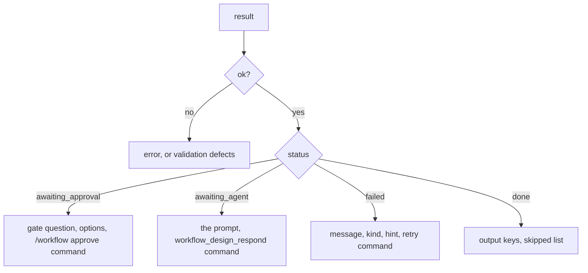

# Tool Runtime

The plugin's two chat-facing surfaces in one class: the `/workflow` slash command and the five
`workflow_design_*` tool handlers. It is the orchestration layer — it loads from the store,
validates with the schema, builds a plan, runs it with the chat-side spawn, and renders results
as chat text.

- Source: `visual_workflow_hermes/runtime.py`
- Class: `WorkflowDesignerRuntime`, constructed once per plugin registration with the host `ctx`.
- Tool methods return **dicts** for internal callers. The host contract (`-> str` JSON) is applied
  by `_as_json` in [`__init__.py`](plugin-entry.md).

## Surface

| Entry | Purpose |
| --- | --- |
| `/workflow` | help/usage |
| `/workflow list` | saved designs |
| `/workflow new <name>` | open a blank designer |
| `/workflow open <name>` | print the saved graph and the canvas hint |
| `/workflow save <name> <json>` | validate and save pasted JSON |
| `/workflow validate <name>` | check a saved design |
| `/workflow run <name>` | run now |
| `/workflow run retry <run_id>` | retry a failed run from its failed step |
| `/workflow approve <run> <gate> <answer>` | answer a gate |

`handle_command` partitions the text once, lowercases the verb, and wraps everything in one
broad `except` that returns `/workflow <verb> failed: <exc>`. A slash command must never crash a
turn; a malformed command returns the usage text.

## Tools

| Tool | Handler | Contract |
| --- | --- | --- |
| `workflow_design_save` | `tool_save` | `{ok, path?, nodes?}` or `{ok: false, error}` |
| `workflow_design_load` | `tool_load` | `{ok, graph?}` or `{ok: false, error}` |
| `workflow_design_validate` | `tool_validate` | `{ok, errors}` |
| `workflow_design_run` | `tool_run` | run result, or `{ok: false, errors?/error}` |
| `workflow_design_respond` | `tool_respond` | run result or `{ok: false, error}` — approval gates are always refused here |

The result shape for a started run is the shared `_result`:

```json
{
  "ok": true,
  "run_id": "...",
  "status": "done | awaiting_approval | awaiting_agent | failed",
  "pending": null,
  "outputs": {},
  "skipped": [],
  "deliveries": [],
  "error": null
}
```

`ok` is false only for a failed run or a refused request. A paused run is a successful call with
a status that tells the caller what to do next.

## Chat-side spawn

`_subagent_spawn(ctx)` returns a spawn backed by `ctx.subagent_lifecycle`
(`launch` → `wait` → `result`), or `None` when the service is absent. This is the full child-agent
path, bound to the active parent session — correct for chat, impossible for the web server.
`ctx.delegation_backends` is not used: it lists and switches backends, it does not launch work.

For each agent step it resolves the model from [`profiles.step_model`](host-catalogs.md), derives
the provider from the catalog, builds a `SubagentLaunchRequest` with the prompt, rendered
context, correlation id `workflow:<run_id>:<node_id>`, optional profile metadata and timeout,
then launches, waits, and turns the result into the runner's `{output, structured, error}` shape.

## Error handling

Every store, plan, and persistence failure is translated, never raised into the dispatcher:

- `tool_save` catches `(ValueError, OSError)` — a bad name or invalid graph.
- `tool_load` catches `(FileNotFoundError, ValueError)`.
- `tool_run` catches `(StepError, ValueError, TypeError, FileNotFoundError, OSError, KeyError)`
  around plan building, the first save, and execution. The `KeyError`/`TypeError` entries are for
  corrupt on-disk state, not for programming errors in the happy path.
- `_tool_run_retry` checks `retryable` first and reports the refusal as a sentence.
- `tool_run` stamps `approved_targets` (the design's delivering set) into the run record at
every human-attended start, including retries.
- `tool_respond` refuses a non-object `pending` record, a mismatched `node_id`, any gate
  whose run record says `awaiting_approval`, and any resume whose current delivering set is
  not a subset of the stamp — all before attempting to resume.

`tool_respond` prefers `structured` over `answer` when both are present, so a JSON result can be
used by downstream conditions while the text remains for display.

## Rendering chat text

`_describe(result)` turns a result into a message that tells the user exactly what to do next:



The failure branch adds `kind` and `hint` as advisory lines under the raw message, then prints
`/workflow run retry <run_id>`.

## Canvas hint

`_widget_hint()` looks for `widgets/designer.html` next to the source checkout first, then under
`sys.prefix` (the installed wheel carries it as a data file). It returns a `::preview{file="..."}`
directive the chat UI can render, which is how `/workflow new` opens the visual designer without a
web route.

## Tests

`tests/test_commands.py` covers the slash command grammar and rendering; `tests/test_runner.py`
covers the run/respond/retry handlers end to end with an injected store and spawn;
`tests/test_hooks.py` covers the `pre_tool_call` escalation and its silent pass-through;
`tests/test_store.py` covers the error contract the handlers rely on.

## Related documentation

- [Plugin Entry](plugin-entry.md) — registration and tool schemas
- [Sequential Runner](sequential-runner.md) — what `tool_run` drives
- [Design and Run Store](design-and-run-store.md) — what the handlers read and write
- [Agent Spawn](agent-spawn.md) — the web-side counterpart spawn
