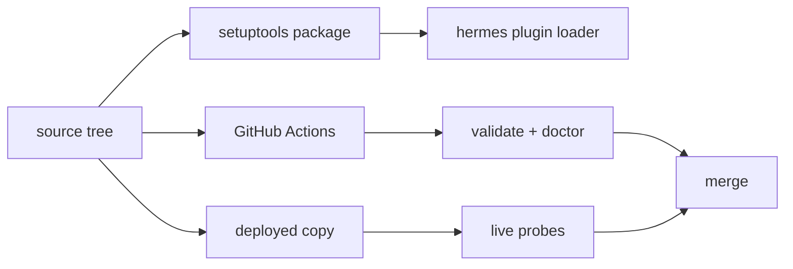

# Repo Operations

Everything around the running plugin: how it is identified and packaged, how CI proves it, and
how a change is verified against the deployed copy rather than only against the source tree.

## Modules

- [Build and Packaging](repo-operations/build-and-packaging.md) — `plugin.yaml`,
  `pyproject.toml`, `node-spec.json`, `.github/workflows/ci.yml`, and the deployed-copy workflow.
- [Live Probes](repo-operations/live-probes.md) — the `.hermes/` browser and Python probes that
  exercise the real host, plus the one-off repair scripts.

## The rule that matters most

A green unit suite against this tree proves nothing about the host. The running plugin is
`~/.hermes/plugins/visual-workflow`, a copy of this repository, and the Desktop app keeps a second
copy of `desktop/plugin.js`. A change is only verified after:

1. the copy is synced;
2. the host rebuilds it (disable + enable);
3. one live probe reproduces the intended behavior;
4. the deployed copy is inspected to confirm the change actually landed.

That sequence is documented in [Build and Packaging](repo-operations/build-and-packaging.md) and
is the reason the probes in [Live Probes](repo-operations/live-probes.md) exist at all.
