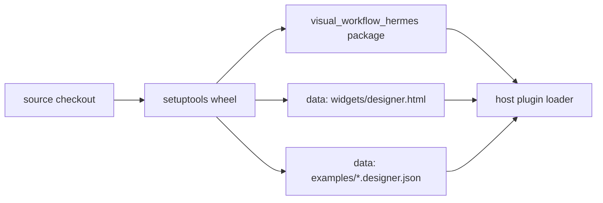

# Build and Packaging

How the plugin is identified, installed, gated, and tested. There is no compile step: the
"build" is a setuptools package that ships one Python package plus two data directories, and the
host's manifest gates are what make a broken registration fail before a user sees it.

- Manifest: `plugin.yaml`
- Package: `pyproject.toml`
- Canvas contract: `node-spec.json`
- CI: `.github/workflows/ci.yml`
- Local live harness: `.hermes/run_live_retry.sh`

## Manifest

`plugin.yaml` declares:

| Field | Value |
| --- | --- |
| `name` | `visual-workflow` |
| `version` | `1.1.0` |
| `kind` | `standalone` |
| `requires_hermes` | `>=0.21` |
| `provides_tools` | the five `workflow_design_*` names |
| `provides_hooks` | one: `pre_tool_call` (model-initiated delivery asks approval) |

The tool list is duplicated in code by design: the host's `hermes plugins validate` compares the
manifest's declaration against the actual `register_tool` calls, so a missing or extra tool is a
gate failure rather than a runtime surprise. The plugin id `visual-workflow` is also the key the
host uses for the model-override trust flag
(`plugins.entries.visual-workflow.llm.allow_model_override`), so renaming it would silently
change which trust gate applies.

## Python package

`pyproject.toml` uses setuptools with:

- `packages = ["visual_workflow_hermes"]` — the flat layout also holds `widgets/`, `examples/`,
  `tests/`, and `dashboard/`, so only the real importable package is declared;
- `pythonpath = ["."]` in the pytest config, so `import visual_workflow_hermes` resolves whether
  tests are run as `pytest` or `python -m pytest`;
- `data-files` for `widgets/designer.html` and `examples/*.designer.json`, because the canvas and
  templates are runtime assets, not importable modules. `runtime._widget_hint` and
  `dashboard/plugin_api.TEMPLATES_DIR` fall back to `sys.prefix` when the source checkout is
  absent, so a wheel install still opens the real designer and lists templates;
- `requires-python >= 3.10`.



## The canvas contract file

`node-spec.json` is a hand-written description of what a canvas may offer:

- each kind's `required` fields mirror `schema.REQUIRED_FIELDS`;
- each field's `tip` is the tooltip key that must exist in all three canvas copies;
- `derives` marks a canvas-only control (`output.send_to`) whose own name must never reach the
  backend, while every name it derives (`deliver`, `target`) must be one the backend reads;
- `limits` mirror the schema (50 nodes, 3 retries, 4320 timeout minutes).

`tests/test_node_spec.py` holds `schema.py` and all three canvases to this file. The point is to
fail loudly on the next drift, not to generate the UIs. Fields the validator accepts but no
canvas edits (agent `schema`/`inputs`/`timeout`) are deliberately absent.

## CI

`.github/workflows/ci.yml` runs on every push and pull request with `contents: read` and a concurrency group that
cancels superseded runs, on a three-OS matrix (`ubuntu-latest`, `macos-latest`,
`windows-latest`, fail-fast off so one red OS never hides the other two).
A 20-minute job timeout makes a hung test or host probe fail instead of
holding a runner.

Steps:

1. checkout, `astral-sh/setup-uv` with caching;
2. the full suite in an ephemeral environment that includes the optional route dependencies:
   `uv run --no-project --python 3.12 --with pytest --with fastapi --with httpx pytest -q`.
   Without fastapi/httpx the route tests skip silently, so CI provisions them deliberately;
3. snapshot the plugin tree aside — `validate` scans its target recursively, so the host
   checkout below must not land inside the scanned directory;
4. checkout the pinned `hermes-agent` build at a fixed commit into the snapshot's sibling;
5. `uv sync --project host --frozen` — locked host dependencies;
6. `hermes plugins validate <snapshot> --install-deps` — manifest, declarations, security scan, desktop surface;
7. `hermes plugins doctor <snapshot>` — the real runtime contracts: discovery, parsing,
   import, registration, tool count.

The host gates are the reason a stale "four tools" docstring or a renamed tool cannot merge: the
validator compares declarations with registrations.

## Live harness

`.hermes/run_live_retry.sh` launches a throwaway server with the dependencies the repo does not
ship:

```bash
uv run --isolated --no-project \
  --with 'fastapi>=0.115,<1' --with 'uvicorn>=0.30,<1' \
  --with 'httpx>=0.27,<1' --with 'ruamel.yaml>=0.18,<1' \
  python3 .hermes/live_retry_server.py "$@"
```

It is a developer probe, not a test and not part of the shipped plugin. Version bounds are
deliberate: a future fastapi/uvicorn major is not automatically compatible with the host's
router expectations.

## Deployed copy

The running plugin is `~/.hermes/plugins/visual-workflow`, a copy of this repository. A source
change is not live until that copy is updated and the host reloads it:

1. sync the copy (it is its own git clone, so a fast-forward is usually enough);
2. `hermes plugins disable visual-workflow && hermes plugins enable visual-workflow` so the host
   rebuilds; the gateway reloads commands immediately and tool schemas on the next session;
3. refresh the Desktop app's own copy under `~/.hermes/desktop-plugins/visual-workflow` if
   `hermes plugins doctor` warns that it is stale (or use Capabilities → Plugins → Rescan);
4. run one live probe, not just unit tests.

A green unit suite against the tree proves nothing about the host still serving the previous
build.

## Related documentation

- [Plugin Entry](../plugin-backend/plugin-entry.md) — the registrations the manifest gates
- [Live Probes](live-probes.md) — the verification harness
- [Standalone Widget](../canvas-frontends/standalone-widget.md) — a packaged data file
