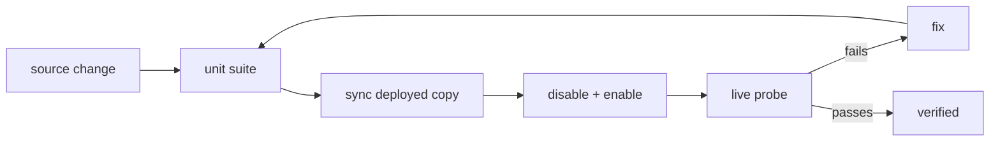

# Live Probes and Repair Scripts

`.hermes/` holds throwaway developer tooling: probes that exercise the **deployed** plugin
against the real Hermes home, browser scripts that measure the canvas, and one-off repairs.
None of it ships, none of it is a pytest test, and the probes must never be mistaken for CI.

- Location: `.hermes/`
- Shared browser loader: `.hermes/probe_browser.js`
- Live server launcher: `.hermes/run_live_retry.sh`
- Plans: `.hermes/plans/` (dated implementation notes)

## Why these exist

The unit suite runs against the source tree with fake stores and fake spawn seams. Some defects
only appear in the real host: a router mounted through the plugin loader, a run persisted under
the real `HERMES_HOME`, a model call through the host facade, or a delivery through the real send
seam. The probes reproduce those conditions deliberately and print evidence.

## Python probes

| Script | Purpose |
| --- | --- |
| `live_approval.py` | create and drive a run that pauses at an approval gate, using the same store/convert/runner path as the run route, minus HTTP |
| `live_approval_check.py` | resume a paused run named on the command line and print the delivery receipt |
| `live_agent_generate.py` | resume a parked run through the deployed respond route with `agent_generate`, using the real host facade and live run store |
| `live_diagnose_probe.py` | one tiny agent step through the deployed spawn seam, to see what a real failure records |
| `live_notify.py` | send a TEST notification through the real delivery seam (dry-run by default; a live send only from `__main__`) |
| `seam_probe.py` | call the host send seam directly with a full traceback; dry-run unless `--live` |
| `check_runs_route.py` | import the deployed `GET /runs` handler and run it against the real run store |
| `live_retry_server.py` | throwaway FastAPI server serving the **deployed** plugin copy, with its root first on `sys.path` |
| `live_http_server.py` | minimal server for the approval-gate HTTP check |
| `repair_run_status.py` | rewrite runs stranded at `"running"` whose cursor reached the end of the plan |
| `fix_probe_run.py` | reset one wedged probe run through the plugin's own store API |
| `split_patch.py` | split an entangled working-tree diff into per-item patches for review/revert |

`repair_run_status.py` is a good example of the rules these scripts follow: derive truth from the
plan (`cursor >= len(steps)` and no pending), never hand-edit a run file, skip an unreadable run
without aborting the batch, and make `state["run_id"]` match the file being rewritten so the
repair cannot write an orphan.

`check_runs_route.py`, `live_agent_generate.py`, and `live_retry_server.py` matter because the
deployed copy, not the tree, is what the host serves — a probe that imports from the checkout
would prove nothing.

## Browser probes

All Playwright probes share `probe_browser.js`, which:

- loads Playwright from a normal `require("playwright")` or `playwright-core`, with the host's
  bundled copy as an optional fallback;
- launches Chromium, using a system Chrome only when `CHROME_PATH` is set;
- requires a session token (`HERMES_DASHBOARD_SESSION_TOKEN` or `TOKEN`) and exits non-zero when
  it is missing, rather than defaulting to a real-looking credential;
- uses `try/finally` to close the browser on every path, including failures.

| Script | Measures |
| --- | --- |
| `probe_shell.js` | shell and canvas geometry, load readiness |
| `probe_chain.js` | which ancestor owns the height above the canvas |
| `probe_heights.js` | height ownership before/after a selection |
| `probe_bisect.js` | hides each child of `.vw-main` to find the 911px owner |
| `probe_layout.js` | layout before/after selecting a node |
| `probe_wrap.js` | wrapper and canvas scroll/size behaviour |
| `probe_widget.js` | the standalone `widgets/designer.html` with no server |
| `probe_item1.js` | run/validate banner behaviour and network calls |
| `probe_run.js` | a full run through the canvas |

Rules the probes follow so a pass is meaningful:

- wait for explicit conditions (selector, banner text, response) instead of fixed sleeps;
- do not use `force: true` clicks, which bypass actionability and hide a covered control;
- assert required selectors exist instead of logging `null` and exiting 0;
- make output paths and base URLs configurable (`BASE`, `PROBE_OUTDIR`, `CHROME_PATH`);
- scope SVG selectors to the canvas rather than clicking the first `svg g` on the page.

## Not shipped

`pyproject.toml` declares only `visual_workflow_hermes` as a package and only `widgets/` +
`examples/` as data files. `.hermes/` is therefore developer-only by construction. Keep it that
way: a probe that grows a runtime dependency belongs in the plugin or in `tests/`, not here.

## Related documentation

- [Build and Packaging](build-and-packaging.md) — the deployed-copy workflow these probes verify
- [Dashboard API](../canvas-frontends/dashboard-api.md) — the routes the HTTP probes call
- [Canvas Core](../canvas-frontends/canvas-core.md) — the layout the browser probes measure
